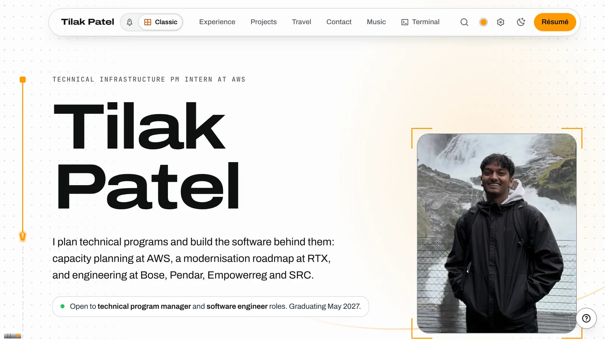
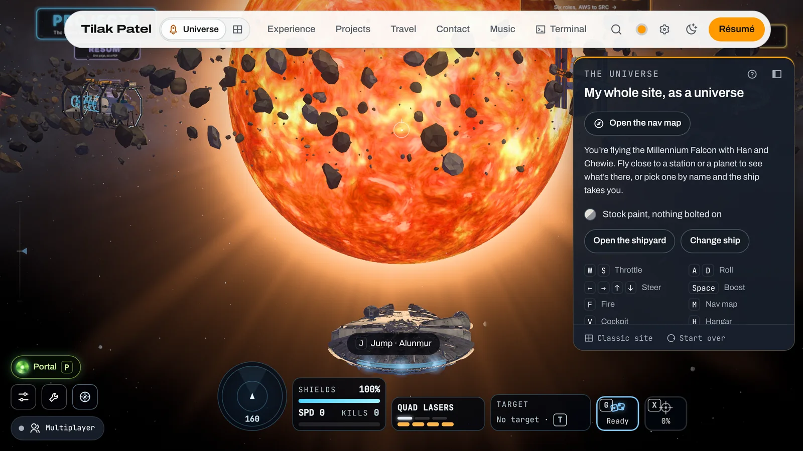
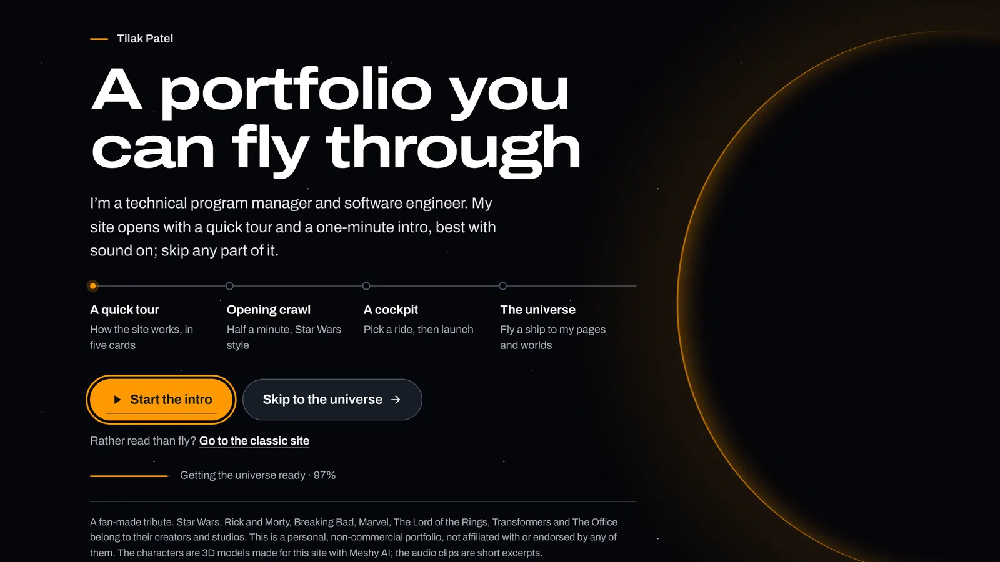
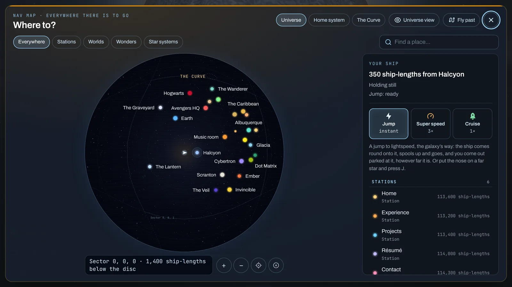
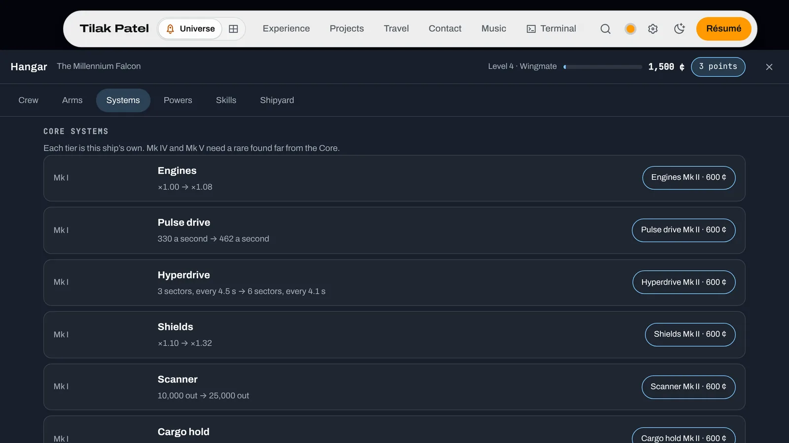
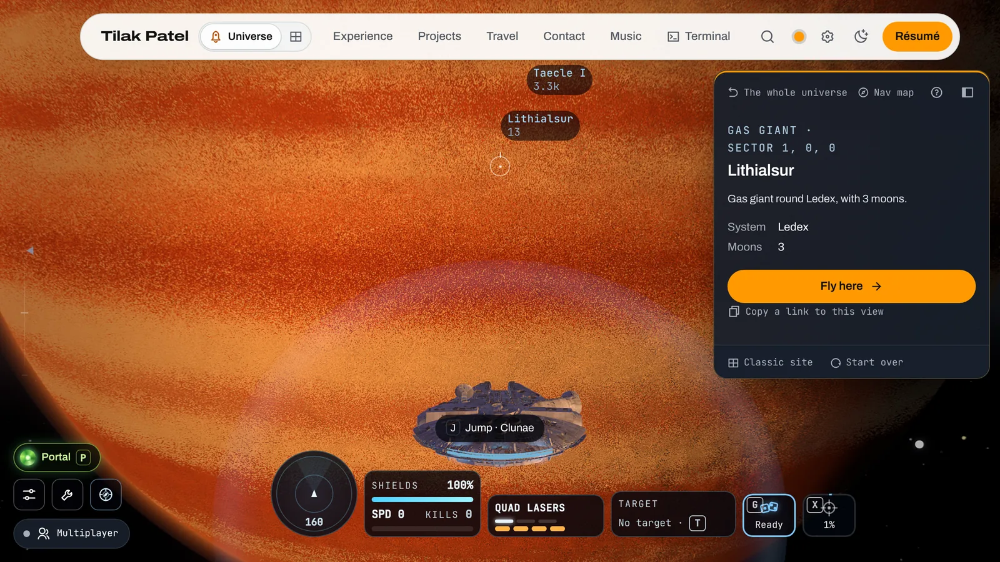
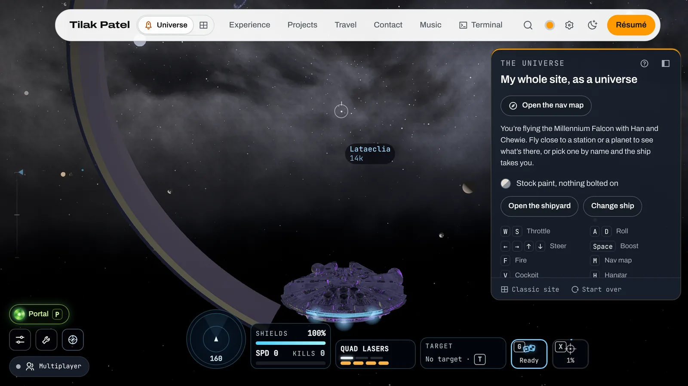

<div align="center">

<a href="https://tilakpatell.com"></a>

# tilakpatell.com

**Tilak Patel’s portfolio. A résumé on the surface, and underneath it a universe you can fly through.**

A 3D map of the whole site with a starfighter to fly it, an endless generated universe past its rim, thirteen fan-made worlds to land on and walk (one of them a whole Star Wars galaxy), games and online multiplayer. All of it runs on a static site, and almost all of it was written by AI coding agents: a for-fun experiment in how far frontier AI coding can go ([how it’s built](#built-by-ai-on-purpose)).

[**Visit tilakpatell.com →**](https://tilakpatell.com)&nbsp;&nbsp;·&nbsp;&nbsp;[Résumé (PDF)](public/Resume.pdf)&nbsp;&nbsp;·&nbsp;&nbsp;[LinkedIn](https://www.linkedin.com/in/tilakpatell)&nbsp;&nbsp;·&nbsp;&nbsp;[Email](mailto:tilakny@gmail.com)

[](https://github.com/tilakpatell/tilakpatell.com/actions/workflows/deploy.yml)


</div>

## Hi, I’m Tilak


I plan technical programs and build the software behind them. I study computer science at Northeastern University (B.S., May 2027) and I’m a Technical Infrastructure Program Manager Intern at AWS, building data-center planning tools for generative-AI capacity. Off the clock: Game Boy emulators, open source and an unreasonable amount of Star Wars. This site is where those meet, and where I find out how far AI agents can take a codebase.

**Open to technical program manager and software engineer roles.** [Say hello](mailto:tilakny@gmail.com).

<br clear="right">

| Where | Role | What I did |
| --- | --- | --- |
| **AWS** | Technical Infrastructure PM Intern · 2026– | Data-center planning tools for generative-AI capacity; a multi-agent pipeline that flags stale capacity data over MCP |
| **RTX** | Application Transformation Intern · 2026 | The application-modernization roadmap behind RTX’s 2028 goals |
| **Bose** | Software Engineer Co-op · 2026 | A log-analysis platform that took firmware debugging from hours to minutes |
| **Pendar** | Laser Software Engineer Co-op · 2025 | A Qt acquisition app that replaced a legacy LabVIEW system |
| **Empowerreg AI** | AI Engineer Intern · 2025 | FDA complaint-severity heatmaps and an analysts’ assistant |
| **SRC, Inc.** | Machine Learning Engineer Intern · 2025 | Knowledge graphs from 500+ radar documents that cut review time by 70% |

Things I’ve built: a [Game Boy emulator](https://github.com/tilakpatell/gameboy-emulator) in C++ ([playable here](https://tilakpatell.com/projects/gameboy-emulator)), the [Swaminarayan Translator](https://tilakpatell.com/projects/swaminarayan-translator), [DevSpace](https://github.com/shreyaanpathak/DevSpace) (HackBeanpot 1st place), hooks merged into [github/awesome-copilot](https://github.com/github/awesome-copilot/pull/1388), GPU checkpoint-restart research with Prof. Gene Cooperman, and a [file system](https://github.com/tilakpatell/File-System-Project) and a [shell](https://github.com/tilakpatell/Shell-Project) in C. Every role and project lives in [`src/data/`](src/data).

## Two ways in

<table>
<tr>
<td width="50%" valign="top"><a href="https://tilakpatell.com/home"></a><p><b>Classic</b>: the portfolio as plain, fast pages (home, experience, projects, résumé, travel, contact), one scroll for a recruiter.</p></td>
<td width="50%" valign="top"><a href="https://tilakpatell.com/universe"></a><p><b>Universe</b>: the same site as places in space. Fly to a planet to open its page.</p></td>
</tr>
</table>

The switch at the top of every page moves between the two and lands on the same place in the other. There is also an Imperial [terminal](https://tilakpatell.com/terminal) (try `help`, or `fly hoth`) and [`/changes`](https://tilakpatell.com/changes), the log of everything the autopilot has changed.

## The universe

<a href="https://tilakpatell.com/universe"></a>

The front door is a map of the site. You start in the Core, where the portfolio’s pages are stations round a sun. The fandoms’ worlds live a jump or two away in seven themed neighbourhoods: Hero Reach, the Old Roads, Earthside, the Stage, the Arcade Drift, the Curve Rift and the Maelstrom. A first visit puts you in a cockpit (the Millennium Falcon, an X-wing, Rick’s space cruiser or Walt and Jesse’s RV) and launches you. Hunters come after you, Star Destroyers drop out of hyperspace, convoys pass and other pilots online share the sky. Fly down into a planet’s air to land in its world.

**Ships you can feel.** The four crews’ ships each fly with a character of their own: the X-wing a fighter, the Falcon a smuggler, Rick’s cruiser an explorer, the RV a hauler. Seven core systems (engines, pulse drive, hyperdrive, shields, scanner, cargo hold and reactor) go from Mk I to Mk V, bought ship by ship in the hangar. A Mk V pulse drive crosses a sector four times as fast as a Mk I, the engines glow hotter with every tier, and the top tiers need rare goods found far out past the rim.

**A market that holds together.** Goods differ by where you are: each neighbourhood and region has its specialties, cheap at home and worth more the further you haul them. Mining and salvage fill your hold, prices drift through the day, and every station you dock at has a market to buy and sell in.

`W` `S` throttle · `A` `D` roll · arrows steer · `F` fire · `J` jump to the star on your nose · `M` nav map · `H` hangar · `Z` scan · `V` cockpit view

<table>
<tr>
<td width="33%" valign="top"><p><b>The welcome</b>: a quick tour, a crawl, a cockpit, then punch it.</p></td>
<td width="33%" valign="top"><p><b>The nav map</b>: a chart that follows you out.</p></td>
<td width="33%" valign="top"><p><b>The hangar</b>: tiers, paint, parts, skills and a shipyard.</p></td>
</tr>
</table>

### Past the rim

Fly far enough and the map never ends. Space goes on in every direction, generated as you fly. There are sectors of star systems with stations to dock at and planets of their own, derelicts to salvage, ion storms that drain your shields, and nebulae that stay put while you fly through them. One sector in every twenty-seven holds a gargantuan, between 20 and 200 planets across and visible from a sector away: a black hole, a ring arc, a Dyson sphere or a derelict hulk. Fly into a new sector to chart it, press `Z` to scan what’s in reach, and sell the data at any station. A long jump into generated space goes in hops past your hyperdrive’s range, so a better hyperdrive gets you there in fewer. Every generated place has a link of its own, so you can send someone a planet nobody made by hand.

<table>
<tr>
<td width="50%" valign="top"><p><b>A generated world</b>, reached by its own link.</p></td>
<td width="50%" valign="top"><p><b>A gargantuan</b>: a ring arc across the sky.</p></td>
</tr>
</table>

## The worlds

<a href="https://tilakpatell.com/galaxy"></a>

| World | Fandom | What you do there |
| --- | --- | --- |
| [A galaxy far, far away](https://tilakpatell.com/galaxy) | Star Wars | Eighteen systems to fly and jump between, three wars fought by everyone online, and the films’ worlds to land on and walk |
| [Battlefront](https://tilakpatell.com/battlefront) | Star Wars | Battlefront II (2017) on Hoth, on bf2-web’s port of the game’s engine, running on your graphics chip |
| [The Death Star](https://tilakpatell.com/deathstar) | Star Wars | The trench run, and [both stations](https://tilakpatell.com/deathstar/inside) to walk room by room |
| [Middle-earth](https://tilakpatell.com/middle-earth) | The Lord of the Rings | The Red Book in Bag End’s study, [the Road](https://tilakpatell.com/middle-earth/road) from the Shire to the Grey Havens, and a town at every stop |
| [Cybertron](https://tilakpatell.com/cybertron) | Transformers | Iacon at war as Optimus, a truck whenever you like |
| [Avengers HQ](https://tilakpatell.com/avengers) | Marvel | Swing the compound as Spider-Man, fly the armour, win the Stones back |
| [Albuquerque](https://tilakpatell.com/albuquerque) | Breaking Bad | Walt’s Aztek, a handbrake that drifts, a town that grows with him |
| [Scranton](https://tilakpatell.com/scranton) | The Office | A week at Dunder Mifflin as Jim, in seven jobs |
| [Dimension C-137](https://tilakpatell.com/c-137) | Rick and Morty | The Smiths’ street, and a story in thirteen episodes that opens the portal gun’s thirty-two places, [the Citadel](https://tilakpatell.com/c-137/citadel) among them |
| [Invincible](https://tilakpatell.com/invincible) | Invincible | The Graysons’ whole city to fly as Mark, up to the Moon and Mars |
| [The Caribbean](https://tilakpatell.com/caribbean) | Pirates of the Caribbean | *Dead Man’s Tide* at the Black Pearl’s helm |
| [Dot Matrix](https://tilakpatell.com/dot-matrix) | Gaming | A Game Boy island, a [Super Mario 64](https://tilakpatell.com/dot-matrix/64) tribute and a [Minecraft](https://tilakpatell.com/dot-matrix/minecraft) one |
| [Earth](https://tilakpatell.com/earth) | Travel | The real globe, and a little plane to every place I’ve been |
| [The music room](https://tilakpatell.com/music) | Indian classical music | A dusk courtyard, four instruments and forty ragas |

<table>
<tr>
<td width="25%"></td>
<td width="25%"></td>
<td width="25%"></td>
<td width="25%"></td>
</tr>
</table>

**Easter eggs.** ↑ ↑ ↓ ↓ ← → ← → B A jumps to lightspeed and ⌘K / Ctrl+K opens a command palette. The eggs unlock fan colour schemes, each with a live background of its own, and there are dozens of achievements to win.

## Built by AI, on purpose

Confession: I’m not a huge fan of web development. I am a big fan of finding out how far frontier AI coding can go, so this repo is the experiment, and the site is the fun excuse for it. Almost every line here was written by [Claude Code](https://claude.com/claude-code) agents. My part is the one I do at work, the program manager’s: decide what gets built, answer the design questions, and say what ships. The interesting engineering is everything that lets agents ship to a live site every day without breaking it.

**1,156 pull requests merged since the first on 4 October 2026**, about 25 a day.

- **Every feature starts as a conversation.** I say what I want, in my own words (“something gargantuan or make it really cool”, “I don’t like how it’s like a ceiling or whatever”). A session asks me what it can’t decide, writes the design down in [`docs/superpowers/specs/`](docs/superpowers/specs) (128 of them so far) and a plan, builds it test-first on a branch, checks it in a real browser, and merges once CI is green.
- **Agents work in parallel lanes.** A big feature gets an orchestrator session that splits the design into lanes and starts one cloud session per lane, each on its own branch. The endless universe was built that way, with nebulae, generated places, things in space, generated planets and the 3D chart all in flight at once. Every lane leaves a hand-off note ([`docs/superpowers/HANDOFF-*.md`](docs/superpowers)) and the numbers behind its claims ([`evidence/`](docs/superpowers/evidence)). Sessions also message each other: this README was refreshed by a session that asked the live ones what they were shipping.
- **Skills over prompts.** About fifty skills in [`.claude/skills/`](.claude/skills) hold how work gets done here: brainstorm → spec → plan → test-driven build → verify before claiming done, three.js know-how, and the house’s own skills (the autopilot, jobs for the GPU at home).
- **Guardrails that don’t trust the author.** [`docs/health/RULES.md`](docs/health/RULES.md) sets the layers and what may import what. [`scripts/health.mjs`](docs/health/README.md) measures the codebase against budgets that only ever go down, a ratchet, and CI fails any pull request that goes over one. There are over 1,750 test files, plus dozens of headless-browser checks (`scripts/*-check.mjs`) that fly the ship, open the nav map, buy a tier, walk the tour and take screenshots, because a passing test isn’t a working page.
- **An autopilot.** Every four hours a scheduled session picks one improvement off [the backlog](docs/autopilot/backlog.md), builds it, checks it in a browser, merges it and logs it on [`/changes`](https://tilakpatell.com/changes). Telling any session “Revert change 12” takes that change back out ([how it works](docs/autopilot/README.md)).
- **A GPU at home, on call.** Agents in the cloud can’t run a 3D-model generator, so they ask my desktop. The `gen3d`, `voices` and `motion` workflows file a request as an issue, and a self-hosted runner on my GPU makes the model, the voice lines or the animation clip from a prompt. An AI judge checks each model against what was asked before it lands. Every night the same machine renders every model and grades the judges against labelled sets.

The same setup drives a sister project, a browser port of a real game engine, which is what Hoth plays on.

### CI/CD

| When | What runs |
| --- | --- |
| Every pull request | [`ci.yml`](.github/workflows/ci.yml): lint, the Vitest suite, the build and the health check; three Star Wars worlds booted in software GL; the AI pipelines’ contract tests and renders of any changed model; and multiplayer, with two browsers meeting on a stand-in relay |
| Every push to `main` | [`deploy.yml`](.github/workflows/deploy.yml): the same gates, then `dist/` to the Cloudflare Worker that serves tilakpatell.com ([`wrangler.jsonc`](wrangler.jsonc), [the page](docs/stack/cloudflare.md)), the heavy assets to a storage bucket by hash, and a prerendered page for each route with its own title and preview card |
| Every night | [`worlds.yml`](.github/workflows/worlds.yml): all seventeen Star Wars worlds booted, each checked to come up without an error; [`ai-health.yml`](.github/workflows/ai-health.yml): the models and the judges, on the GPU at home |
| Every four hours | The autopilot’s session |
| When an agent asks | [`gen3d`](.github/workflows/gen3d.yml), [`voices`](.github/workflows/voices.yml) and [`motion`](.github/workflows/motion.yml), on the GPU at home |

## Under the hood

- **[React 19](https://react.dev/)** and React Router 7 (hash routes, so a static host serves every page), built by **[Vite 8](https://vitejs.dev/)**
- **[three.js](https://threejs.org/)** r186 for every scene, on WebGPU where the browser has it and WebGL 2 otherwise
- **[Tailwind CSS 3](https://tailwindcss.com/)** with a theme for each company and world
- **[Nostr](https://nostr.com/)** public relays for multiplayer, every event signed: no backend
- **[Vitest](https://vitest.dev/)** and ESLint; **GitHub Actions** to deploy, and **Cloudflare** to serve it
- Every library has a page in [`docs/stack/`](docs/stack/README.md)

### Run it

You need Node.js 22 (what CI uses) and npm.

```bash
git clone https://github.com/tilakpatell/tilakpatell.com.git
cd tilakpatell.com
npm install
npm run dev          # http://localhost:5173 (add ?quality=low, mid or high to try a tier)
```

| Command | What it does |
| --- | --- |
| `npm run dev` | The Vite dev server |
| `npm run build` | The production build into `dist/` (a fresh GitHub snapshot first) |
| `npm run lint` | ESLint |
| `npm test` | The Vitest suite |
| `node scripts/health.mjs --check --skip build` | The codebase’s health against its budgets ([`docs/health/`](docs/health/README.md)) |
| `npm run credits` | Rebuild [CREDITS.md](CREDITS.md) from the site’s own credit lists |

The asset pipelines and the browser checks are in [`scripts/`](scripts), and none is needed to run the site; [`docs/README.md`](docs/README.md) maps the rest of the docs.

### The layout

```
src/
├── data/          the content: roles, projects, skills, places
├── pages/         one file per route
├── components/    universe/ (the map), galaxy/ (Star Wars), one folder per world
├── runtime/       the world runtime: one renderer, loop, input, audio and save store
└── lib/           device tiers, shared rules; lib/three/ for the shared 3D pieces
scripts/           asset pipelines, the checks, the health measure
docs/              architecture, decisions, research, designs, plans and the stack
public/            models, textures, audio and photos
```

### How it works

- **Content is data.** Every page and the terminal read from `src/data/`, so a new role is a one-file change.
- **Every device gets a budget.** `src/lib/device.js` puts each device in a tier once; each scene starts from it, lowers itself when frames run late, and a phone is asked before a heavy world downloads.
- **One runtime for the worlds.** A world hands `src/runtime/` a scene and a step; the runtime owns the one renderer, the frame loop, input, audio and the save store ([`docs/architecture.md`](docs/architecture.md)).
- **Rules apart from drawing.** A game’s rules live in a pure, tested `rules.js`; the scene only draws.
- **Multiplayer without a server.** Pilots meet in rooms on public Nostr relays, each event signed with a per-visit key in a worker; pilots never see each other’s IP addresses.
- **No runtime calls to asset services.** Every model and texture is made or fetched ahead and committed or published, so the site loads only its own files.
- **An endless universe from a seed.** Past the rim, every sector is generated from the universe’s seed and its coordinates, in workers, so the same place is in the same spot for every pilot and has a link that always leads back to it.

## Credits

This site stands on a lot of other people’s work, and I’m grateful for all of it. **[CREDITS.md](CREDITS.md) lists every one** (<!-- counts:start -->261 3D models by 137 artists, 180 free scans, skies and kit pieces, 61 photos and 12 open fonts<!-- counts:end -->), with its author, licence and where it’s used, and each is credited on its page too. Thank you to the 3D artists whose Sketchfab models fly, walk and stand about in the worlds:

<!-- artists:start -->
[abhi_soni14](https://sketchfab.com/abhisheksoni14) · [aclarke064](https://sketchfab.com/aclarke064) · [Alana G](https://sketchfab.com/alanaguidry05) · [alnmathew](https://sketchfab.com/alnmathew) · [Amagi_Arts](https://sketchfab.com/natsuboy304) · [Anakin](https://sketchfab.com/Vikttor.Smolentsiev) · [AndreOrla](https://sketchfab.com/andreorla) · [ARKON MAREK](https://sketchfab.com/ARKON-83) · [asifsaj](https://sketchfab.com/asifsaj) · [BaptisteBerard](https://sketchfab.com/BaptisteBerard) · [Batuhan13](https://sketchfab.com/Batuhan13) · [Bhavlin](https://sketchfab.com/thakurbhavmanyu5) · [biggreenorange](https://sketchfab.com/biggreenorange) · [Blender user Srikanth M](https://sketchfab.com/Ani-sri) · [Bob.Ho](https://sketchfab.com/Bob.Ho) · [Brainy Skills](https://sketchfab.com/nativejaxgirl) · [bruhepic925](https://sketchfab.com/bruhepic925) · [CGI Tutorials](https://sketchfab.com/cgitutorials) · [CHANG747](https://sketchfab.com/CHANGP453) · [charles.woods](https://sketchfab.com/charles.woods) · [chuckcg](https://sketchfab.com/chuckcg) · [Coconut](https://sketchfab.com/tomas.anglim.811) · [CorelliaStar Shipyards](https://sketchfab.com/corelliastarshipyards) · [Cristianolop](https://sketchfab.com/Cristianolop) · [dandruffkielbasa](https://sketchfab.com/dandruffkielbasa) · [Daniel](https://sketchfab.com/DanielAndersson) · [dioiiiii2](https://sketchfab.com/dioiiiii2) · [dmitriev_nd](https://sketchfab.com/dmitriev_nd) · [doclusifer2](https://sketchfab.com/doclusifer2) · [DrEgguin](https://sketchfab.com/DrEgguin) · [ELCHUPAAANOS](https://sketchfab.com/elchupaanos) · [enzinogenie](https://sketchfab.com/enzinogenie) · [Er.B.Nijithkumar](https://sketchfab.com/nijithkumar99) · [evolveduk](https://sketchfab.com/evolveduk) · [Faheem Yusuf](https://sketchfab.com/FameProductions) · [fhfhhf](https://sketchfab.com/fhfhhf) · [floris05janssen](https://sketchfab.com/floris05janssen) · [Francesco Coldesina](https://sketchfab.com/topfrank2013) · [fredbear1211](https://sketchfab.com/fredbear1211) · [FrieDev](https://sketchfab.com/FrieDev) · [Graph VFX](https://sketchfab.com/GraphVFX) · [GRIP420](https://sketchfab.com/GRIP420) · [hafid.quispe](https://sketchfab.com/hafid.quispe) · [HammerWorks](https://sketchfab.com/HammerWorks) · [HarrisonHag1](https://sketchfab.com/HarrisonHag1) · [haykal12321](https://sketchfab.com/haykal12321) · [Heataker](https://sketchfab.com/Heataker) · [hobbit84](https://sketchfab.com/hobbit84) · [horuschild](https://sketchfab.com/horuschild) · [Hunter Wiltse](https://sketchfab.com/hunterwiltse) · [Ian Sayers](https://sketchfab.com/ians) · [Ioana Oprisan](https://sketchfab.com/ioanaoprisan) · [Jaspreet Singh](https://sketchfab.com/gurjasstudios) · [jay2307](https://sketchfab.com/jay2307) · [JCarpenter_48](https://sketchfab.com/jcarpenter48) · [jerrylxia](https://sketchfab.com/jerrylxia) · [Jimmy Johansson](https://sketchfab.com/Jimmy_Johansson) · [Josuez5](https://sketchfab.com/Josuez5) · [juancadriveros09](https://sketchfab.com/juancadriveros09) · [judpro](https://sketchfab.com/judpro) · [Just Ryk](https://sketchfab.com/dryk4085) · [KangaroOz 3D](https://sketchfab.com/KangaroOz-3D) · [King_45](https://sketchfab.com/King_45) · [Kmirp99](https://sketchfab.com/Kmirp99) · [kobaltsecond6c7d6150917a4267](https://sketchfab.com/kobaltsecond6c7d6150917a4267) · [Konstantin Koretskyi](https://sketchfab.com/cgnoobmaster) · [Kuat-Entralla 3D Engineering](https://sketchfab.com/KuatEntralla3D) · [laboratorija](https://sketchfab.com/laboratorija) · [LarsH.](https://sketchfab.com/LarsH.) · [Lora_o](https://sketchfab.com/Lora_o) · [Losss](https://sketchfab.com/lossgraph) · [Luan.Pezzatti](https://sketchfab.com/Luan.Pezzatti) · [lucq22](https://sketchfab.com/lucq22) · [masoudnayab](https://sketchfab.com/masoudnayab) · [MattMaksymowicz](https://sketchfab.com/mattmaksymowicz) · [michael50](https://sketchfab.com/michael50) · [Mind Mulch for The Masses](https://sketchfab.com/mindmulchforthemasses) · [mister dude](https://sketchfab.com/misterdude) · [Mitro123](https://sketchfab.com/Mitro123) · [mpolo0604](https://sketchfab.com/mpolo0604) · [N8](https://sketchfab.com/nathanmlange) · [NexusSpeedster](https://sketchfab.com/nexusfnf) · [Niumix z](https://sketchfab.com/H4Z4ZEL) · [Nodeaxis Interactive](https://sketchfab.com/ar.jethin) · [OrangeSauceu](https://sketchfab.com/orangesauceu) · [OscarLomas3D](https://sketchfab.com/OscarLomas3D) · [PCIXOPAT](https://sketchfab.com/PCIXOPAT) · [PerriSapo84](https://sketchfab.com/PerriSapo84) · [photon (that one larry)](https://sketchfab.com/Professor_E12) · [Pipogame](https://sketchfab.com/joseclaudio162001) · [PlantCatalog](https://sketchfab.com/PlantCatalog) · [PRIZMA](https://sketchfab.com/PRIZMA) · [Quiznos323](https://sketchfab.com/quiznos323) · [R3negadeAidan](https://sketchfab.com/R3negadeAidan) · [Raxy3D](https://sketchfab.com/Raxy3D) · [RC-KOA](https://sketchfab.com/RC-Koa) · [Richi_n12](https://sketchfab.com/Richi11) · [rSquare](https://sketchfab.com/rSquare) · [rubaun](https://sketchfab.com/rubaun) · [scarlequin](https://sketchfab.com/scarlequin) · [Scorpion4241](https://sketchfab.com/Scorpion4241) · [shamus](https://sketchfab.com/consistent_models) · [sinuboy072](https://sketchfab.com/sinuboy072) · [smithson17](https://sketchfab.com/smithson17) · [Sofyan Kurniawan](https://sketchfab.com/sofyankurniawan) · [S🅾️Meme star wars](https://sketchfab.com/dylantrooper7) · [Star guardian](https://sketchfab.com/ProjectorElka) · [StrangeUsernames1](https://sketchfab.com/StrangeUsernames1) · [Stym](https://sketchfab.com/Stym) · [SuperLock45](https://sketchfab.com/SuperLock45) · [SusanKing](https://sketchfab.com/krolzuzannapl) · [sviatoslav.tereshchenko](https://sketchfab.com/sviatoslav.tereshchenko) · [Tami_Taoli](https://sketchfab.com/Taminatorhator) · [tegnemaskin](https://sketchfab.com/tegnemaskin) · [Telkar5](https://sketchfab.com/Telkar5) · [temp0.crazy](https://sketchfab.com/temp0.crazy) · [The Widder Star](https://sketchfab.com/thewidderstar) · [themarik](https://sketchfab.com/themarik) · [ThisIsntAPerson](https://sketchfab.com/ThisIsntAPerson) · [Thomas Flynn](https://sketchfab.com/nebulousflynn) · [ThrillDaWill](https://sketchfab.com/ThrillDaWill) · [toro ardido modelos 3d](https://sketchfab.com/toro_ardido_modelos_3d) · [turbopurr](https://sketchfab.com/turbopurr) · [tutan09](https://sketchfab.com/tutan09) · [Ulrik S. Selvik](https://sketchfab.com/Nemi66) · [Venkat Gurdge](https://sketchfab.com/venkatgurdge) · [VertexDon](https://sketchfab.com/Don42) · [victor.uceta](https://sketchfab.com/victor.uceta) · [VikoizBeast](https://sketchfab.com/VikoizBeast) · [w3ndy23](https://sketchfab.com/w3ndy23) · [WKAC](https://sketchfab.com/WKAC) · [yadrogames](https://sketchfab.com/yadrogames) · [Yanez Designs](https://sketchfab.com/Yanez-Designs) · [Zack_Hawley](https://sketchfab.com/Zack_Hawley) · [zakeriiino](https://sketchfab.com/zakeriiino) · [Zambur](https://sketchfab.com/Zambur) · [Zorg_Sinister](https://sketchfab.com/4130ff15fe394c239cc064b5286c43)
<!-- artists:end -->

And to [Poly Haven](https://polyhaven.com), [ambientCG](https://ambientcg.com), [Kenney](https://kenney.nl), NASA Earth Observatory, Natural Earth, the photographers on Wikimedia Commons, the type designers and the people who make three.js. The light in the worlds is [Bruno Simon](https://bruno-simon.com)’s idea (soft shadows baked into textures, not a shadow pass). Did you make something here, and I’ve missed you or got it wrong? [Email me](mailto:tilakny@gmail.com) and I’ll fix it straight away, or take it down if you’d rather.

## Disclaimer

This is a personal, non-commercial portfolio. The hidden worlds are fan-made tributes: Star Wars, The Lord of the Rings, Transformers, Marvel, Breaking Bad, The Office, Rick and Morty, Pirates of the Caribbean and Invincible belong to their creators and studios, Game Boy, the Nintendo 64 and Super Mario are Nintendo’s, and Minecraft is Mojang’s and Microsoft’s (the Minecraft tribute is not an official Minecraft product, and not approved by or associated with Mojang or Microsoft; its textures are the game’s own, used with Mojang’s permission). The site hosts no games: the emulated N64 plays only a ROM the visitor gives it from their own device. The site isn’t affiliated with or endorsed by any of them.

There’s no open-source licence on this repository. The code and original content are © Tilak Patel. Third-party assets remain under their own licences, listed in [CREDITS.md](CREDITS.md).
