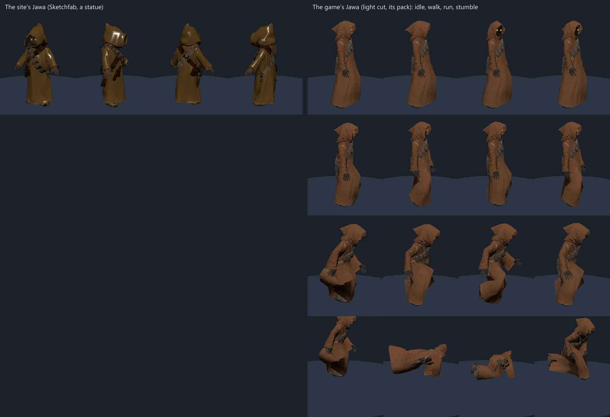
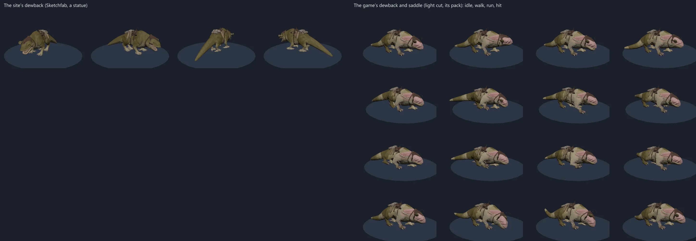
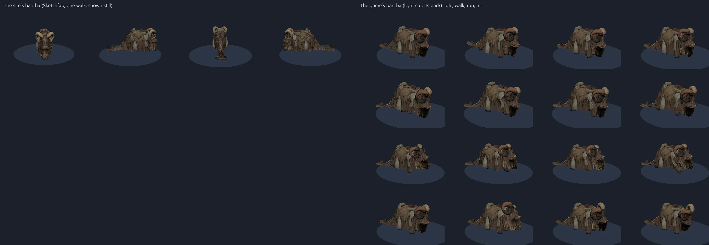
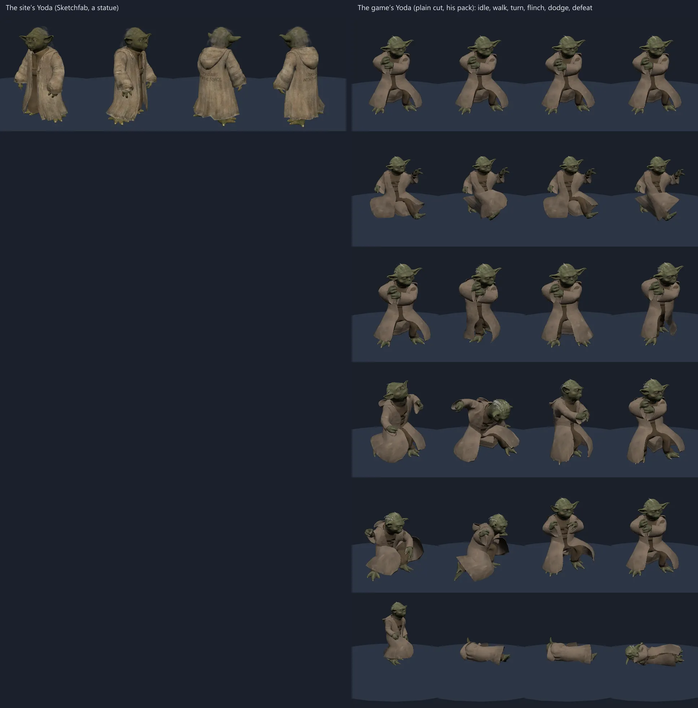
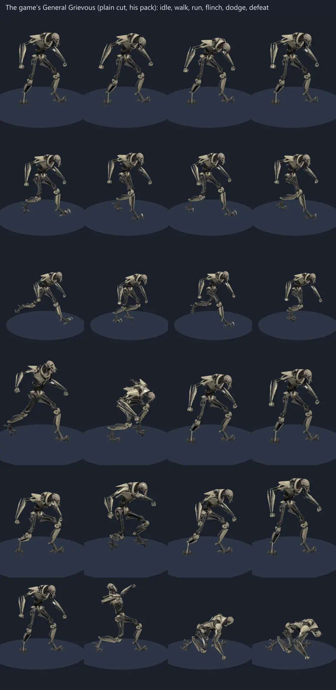
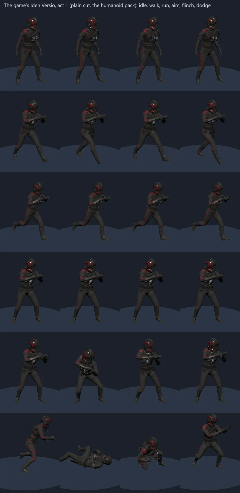
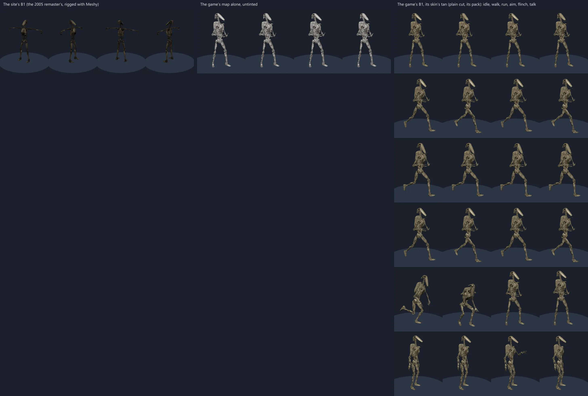

# Lane C4: the kinds the game has, brought in from the export

The plan: [`plans/2026-10-21-bf-default-C4-kinds-from-the-export.md`](../../plans/2026-10-21-bf-default-C4-kinds-from-the-export.md) (the design’s decision 5). Made on the owner’s desktop from the export at `C:\Users\tilak\Downloads\BF2_Extract\web`, read through the scripts’ `--root C:/Users/tilak/Downloads/BF2_Extract`.

## The root

The export’s `web/` is laid out as the bucket’s fetch is (`lab/assets/bf2017/web/`): `models.jsonl`, `textures.jsonl` and `anims.jsonl`, the models under `models/`, their maps under `textures/` and the clips under `anims/`, so `bf2017-import.mjs` and `bf2017-clips.mjs` read it as they are. Two differences: its maps are the PNGs the uploader made, not the bucket’s KTX2 (so a `--full` plain cut takes AVIF, as for any map the bucket has only as PNG, and its `fullMB` is that decode’s, not the KTX2’s), and its records are `web/data/<Name>.json`, not `data/<Name>.json.gz`. `bf2017-fauna.mjs` takes `--root` and passes it on, and fetches nothing then.

## The kinds, each beside the site’s

Each sheet is `scripts/clip-shot.mjs` through the dev server: the game’s light cut playing its rig’s pack (`--pack`), four moments a clip; the site’s file as it is (a statue from four sides). Software GL (SwiftShader).

| kind | the game’s | cuts committed (triangles, bytes) | pack | full cut (waits on the owner) | the site’s | which is better |
| --- | --- | --- | --- | --- | --- | --- |
| `jawa` | `characters/npc/creatures/jawa/jawa_01/jawa_01_mesh`, own rig `Jawa_01_Ske` | plain LOD2 4,532, 209 KB; light LOD4 1,110, 174 KB; far LOD5 332, 35 KB | 7 clips, 176 KB | LOD0 18,432, 2.7 MB | `surface/jawa.glb`, Sketchfab, a statue, 239 KB | **the game’s**: the same robe and lit eyes, and it stands, walks, runs and stumbles on the game’s own clips where the statue slid |
| `dewback` | `…/dewback/dewback_01/dewback_01_mesh` with `dewback_01_saddle_mesh`, own rig `Dewback_01_Ske` | plain LOD2 8,672, 353 KB; light LOD3 3,488, 309 KB; far LOD5 438, 49 KB | 6 clips, 111 KB | LOD0 35,244, 4.7 MB | `surface/dewback.glb`, Sketchfab, a statue, 187 KB | **the game’s**: the statue is finer close up, but it is a statue; the game’s walks, trots, breathes and flinches under its saddle |
| `bantha` | `…/bantha/bantha_01/bantha_01_mesh`, own rig `Bantha_01_Ske` | plain LOD3 10,523, 831 KB; light LOD4 5,237 (maps at 512 and 256), 337 KB; far LOD5 2,603, 133 KB | 6 clips, 97 KB | LOD0 71,778, 9.5 MB | `surface/bantha.glb`, Sketchfab, the same body (an upload of the game’s), one walk, 428 KB | **the game’s**: the same beast from its own files, with its idles, walk, run and flinch, its LOD chain and a far cut |
| `yoda` | `characters/hero/yoda/yoda_01/yoda_01_mesh` with `yoda_01_robe_skinned_mesh`, own rig `Yoda_01_Ske` | plain LOD1 18,828, 641 KB; light LOD4 1,940 (512 and 256), 224 KB; far LOD5 713, 108 KB | 16 clips, 454 KB | LOD0 36,149, 9.4 MB | `surface/yoda.glb`, Sketchfab, a statue, 295 KB | **the game’s**: the statue’s cloth reads finer close up, but it is a statue, arms held out, with a fan’s words printed on the back of its robe; the game’s is the films’ Yoda in his own robe, and he stands in his guard, walks, turns, flinches, dodges and falls on his own clips |
| `grievous` | `characters/hero/generalgrievous/generalgrievous_01/generalgrievous_01_mesh`, own rig `GeneralGrievous_01_Ske` | plain LOD2 17,881, 899 KB; light LOD4 2,377 (512 and 256), 302 KB; far LOD5 943, 150 KB | 18 clips, 1.07 MB | LOD0 70,665, 8.5 MB | none | new: no world places him yet |
| `iden` | `characters/hero/iden/act1/iden_act1_01/iden_act1_01_mesh` with her balaclava and Inferno Squad’s helmet, tubes and chest box (the act 1 outfit record, `VUR_Iden_Act1_01`), humanoid rig | plain LOD1 27,915, 681 KB; light LOD4 1,873 (512 and 256), 214 KB; far LOD5 660, 114 KB | the humanoid pack | LOD0 55,429, 7.1 MB | none | new: no world places her yet |








Each takes over its kind where Tatooine places it (`surface/sites/desert.js`’s life: the Jawa traders at the landing and the seven in the dunes, the bantha herd by the Tusken camp, the dewbacks by the sandtroopers; and Dantooine’s banthas and Arvala’s Jawas): a crew row is tried before the catalogue’s (`surface/cast.js`). The bantha you ride stays the built one (`rides.js`).

## The heroes

Yoda and Grievous are on skeletons of their own (`src/lib/three/walrusSets/ownHeroes.js`, their packs by `bf2017-clips.mjs yoda|grievous --root`) and Iden Versio is on the humanoid one, so all three are imported as heroes: the plain cut held to the hero’s 4 MB (each came well under 1 MB), the game’s LOD1 (LOD2 for Grievous) at 1024 and 512. The sheets are their plain cuts, the file their rows draw. Their light cuts are the import’s `--full` ones at 512 and 256: at 1024 and 512 each light cut held 24 to 33 MB of textures, over the 16 MB a hero’s light cut is held to (`crew.budget.test.js`).

On the roster (`galaxy/heroes.js`) Yoda and Grievous are `soon`: the saber is one path on the humanoid rig (`HANDOFF-battlefront.md`), and theirs do not fence yet. Their cards carry the game’s kit where the site plays the kind (Yoda’s dash, Grievous’s claw rush and unrelenting advance, `abilityRules.js`, the game’s icons in `lib/bf2017/icons.js`). As people on the worlds they stand and walk now: Yoda takes over the catalogue’s statue on Dagobah, Coruscant and Kashyyyk. Iden is a cast row, a hero candidate with her blaster when her kit (a droid shield, a pulse cannon, a droid stun) has kinds the site plays. Act 3’s Iden is the sequel era’s: the import now refuses `a3/` and act 3 paths (`isActThree`, `scripts/lib/bf2017-manifest.mjs`) as it does the sequel’s names.

## The B1

The hand-off had the game’s B1 waiting on “its markings map”. The export says there is none to wait on for its default skin: the B1’s colour maps (`T_D_Assault_Preq_01_Torso_CS`, `_Limbs_CS`, `_Head_CS`, `_Backpack_CS`) are grey, drawn by `SS_CharactersPreset_RobotMarkings`, and the skin’s ObjectVariation records (`Characters/Markings/D_Preq/Troopers/Default/D_Assault_Preq_01_Default` and `…_BackPack_Default`, under `web/data`) give that shader one colour, `Color0_Base` 0.638, 0.565, 0.366 (linear): the films’ tan, which the game multiplies the map by. The markings masks the export has under `textures/characters/markings/d_preq/` (`D_Preq_T_Default_*_Markings`, the Geonosis, Kashyyyk, pilot and training skins’) lay their colours over that only in the skins that bind one; the default binds none.

So the import takes `--tint <records>` (`scripts/lib/bf2017-markings.mjs`, tested, and a test of the import on a fixture droid): the records’ one `Color0_Base` set as the base colour factor of every material drawn with the markings preset, the map itself left as the game made it.

| | the game’s B1 | the site’s |
| --- | --- | --- |
| body | `characters/dark/d_assault_preq/d_assault_preq_01/d_assault_preq_01_mesh` with its backpack, own rig `D_Assault_Preq_01_Ske` (`OWN_RIGS.b1`) | `troops/battledroid.glb`, the 2005 remaster’s, rigged with Meshy, 2,592 triangles, 170 KB |
| cuts committed | plain LOD3 4,284 triangles, 836 KB (a fielded kind, drawn in squads and at every distance until its row is `full`: LOD2’s 8,543 would be three times the remaster’s 2,592 a droid); light LOD4 2,096 (512 and 256), 302 KB; far LOD5 1,011, 118 KB | |
| pack | `clips-b1.glb`, 19 clips, 369 KB | |
| full cut (waits on the owner) | LOD0 34,600, 8.7 MB | |



**The game’s B1 is better**, and `battledroid`’s row is swapped to it: the remaster’s is darker and grimier than the films’ droid (shot as its file stands; on the site it moves on the clips Meshy’s rig takes, not the game’s); the game’s untinted map is grey, as the middle column shows, and with its skin’s tan it is the films’ B1, with its backpack, standing, walking, running, aiming, flinching and talking on its own clips.

The row is fielded (the Separatists’ squads and crowds) and worn (their four trooper classes), so it was walked on a real GPU (ANGLE on D3D11, the dev server): on Geonosis 27 of the world’s battle droids were drawn and rigged, and deployed as the Separatists’ assault class the player was the game’s B1 with the E-5 in its hand. `heroSpec` and `troopers.js` now carry a trooper’s own rig (`rig: 'own'`, `ownRig`), which the B2 enforcer also lacked.

## What waits on the owner

The session had no bucket key, so nothing was published. The rows draw the committed plain, light and far cuts; the full cuts, the game’s LOD0 at its own maps, come with the owner’s publish:

```
node scripts/bf2017-fauna.mjs jawa,dewback,bantha --far --root C:/Users/tilak/Downloads/BF2_Extract
node scripts/assets-publish.mjs --only 'models/galaxy/bf2017/crew/jawa*,models/galaxy/bf2017/crew/dewback*,models/galaxy/bf2017/crew/bantha*,models/galaxy/bf2017/clips-jawa.glb,models/galaxy/bf2017/clips-dewback.glb,models/galaxy/bf2017/clips-bantha.glb'
node scripts/assets-check.mjs
```

and for the three heroes and the B1 (the same flags these cuts were made with; the import’s plain cut is then the game’s LOD0, which goes to the bucket):

```
node scripts/bf2017-import.mjs characters/hero/yoda/yoda_01/yoda_01_mesh --kind yoda --as 'The game’s Yoda' --rig --crew --full --join --far --cuts lod1=4 --lod1-tex 512 --lod1-maps 256 --parts '*_robe_skinned_mesh' --root C:/Users/tilak/Downloads/BF2_Extract
node scripts/bf2017-import.mjs characters/hero/generalgrievous/generalgrievous_01/generalgrievous_01_mesh --kind grievous --as 'The game’s General Grievous' --rig --crew --full --join --far --cuts lod1=4 --lod1-tex 512 --lod1-maps 256 --root C:/Users/tilak/Downloads/BF2_Extract
node scripts/bf2017-import.mjs characters/hero/iden/act1/iden_act1_01/iden_act1_01_mesh --kind iden --as 'The game’s Iden Versio (Inferno Squad, act 1)' --rig --crew --full --join --far --lod1-tex 512 --lod1-maps 256 --parts '*_balaclava_mesh,characters/hero/_shared/infernosquad_01/infernosquad_01_helmet_mesh,characters/hero/_shared/infernosquad_01/infernosquad_01_tubes_mesh,characters/hero/_shared/infernosquad_01/infernosquad_01_chestbox_mesh' --root C:/Users/tilak/Downloads/BF2_Extract
node scripts/bf2017-import.mjs characters/dark/d_assault_preq/d_assault_preq_01/d_assault_preq_01_mesh --kind battledroid --as 'The game’s B1 battle droid' --rig --crew --full --join --far --cuts lod1=4 --lod1-tex 512 --lod1-maps 256 --parts '*_backpack_mesh' --tint 'Characters/Markings/D_Preq/Troopers/Default/D_Assault_Preq_01_Default,Characters/Markings/D_Preq/Troopers/Default/D_Assault_Preq_01_BackPack_Default' --root C:/Users/tilak/Downloads/BF2_Extract
node scripts/assets-publish.mjs --only 'models/galaxy/bf2017/crew/yoda*,models/galaxy/bf2017/crew/grievous*,models/galaxy/bf2017/crew/iden*,models/galaxy/bf2017/crew/battledroid*,models/galaxy/bf2017/clips-yoda.glb,models/galaxy/bf2017/clips-grievous.glb,models/galaxy/bf2017/clips-b1.glb'
```

then each row in `src/lib/cast/bodies.js` gains `full: true, fullMB, fullDL` as the import prints them (from the export’s PNGs: Jawa 86 and 3, dewback 107 and 5, bantha 130 and 10, Yoda 198 and 10, Grievous 192 and 9, Iden 278 and 8, the B1 160 and 9; from the bucket’s KTX2 the GPU’s number is about a quarter, and the heroes’ 192 to 278 MB from PNG are over the high level’s 128 MB share, so their full cuts want the bucket’s KTX2 before they are `full`).
