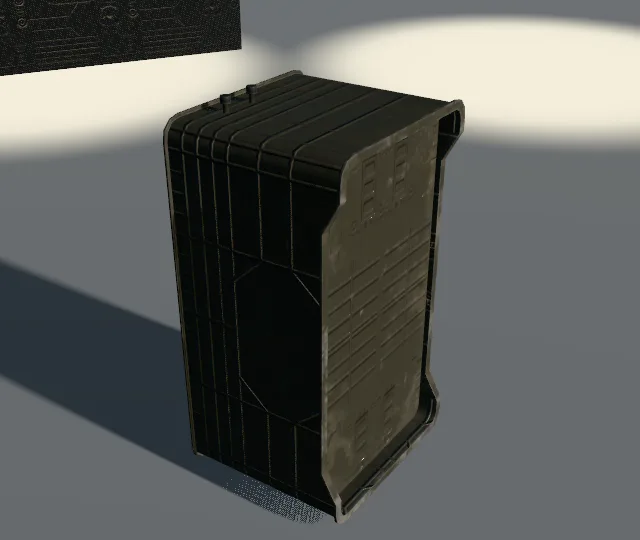
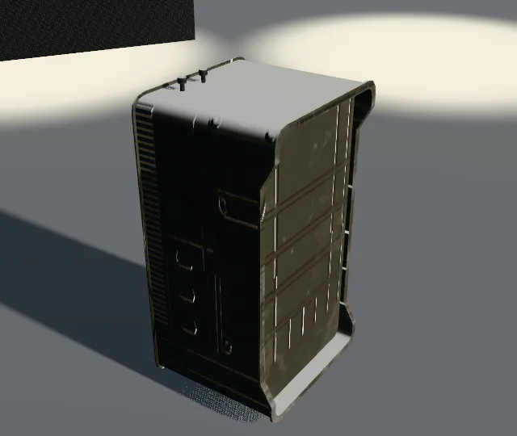

# The colours, everywhere: what the audit found and what the worlds look like

The design: `docs/superpowers/specs/2026-10-10-bf2017-colours-everywhere-design.md`. The session had no bucket key, so every number here is from the files on `main` at `e128ec47` (#371) and the roles already committed.

## The audit (`node scripts/bf2017-colour-check.mjs`)

Before the fix, over `public/models/galaxy/bf2017` (the packs hoth, sb_endor, sb_kamino, and fx):

| files | colour maps sRGB | colour maps linear (wrong) | data maps linear | data maps sRGB (wrong) | unknown |
| --: | --: | --: | --: | --: | --: |
| 907 | 132 | **180** | 588 | 0 | 7 |

The 180 are every UASTC-encoded `_cs` and `_c` map in the packs; the 132 sRGB ones are the ETC1S encodes. The seven unknown are `t_swatch_*` maps with no suffix; `--formats web/textures.jsonl` decides them (the plan's task 5). After `--fix`: 312 colour maps sRGB, 0 wrong. The 29 roles: whole (three maps each where the index says, every one credited EA DICE's).

## The worlds on the game's roles

`QUALITY=high` in software GL through `scripts/galaxy-check.mjs surface tatooine,endor,naboo`, the page's clock held and its random numbers seeded, so the two runs see the same world. `before-*.png` is `main` (the photo scans, `scans cc0 n game 0`); `after-*.png` is this branch (`siteOf`'s default `look.scanned: 'bf2017'`, `scans cc0 0 game n`). The counts (draw calls, triangles, textures, models MB) do not move: the roles are the same roles under the same `wear`/`dress`, only their files differ.

| world | before | after | scans fetched before → after |
| --- | --- | --- | --- |
| tatooine | `before/tatooine-high.jpg`: calls 94, tris 689,584, tex 303, models 26.1 MB | `after/tatooine-high.jpg`: calls 86, tris 689,352, tex 303, models 26.1 MB | cc0 47 → 0, game 3 → 39 |
| endor | `before/endor-high.jpg`: calls 216, tris 1,842,216, tex 330, models 14.5 MB | `after/endor-high.jpg`: calls 216, tris 1,842,216, tex 330, models 14.5 MB | cc0 49 → 0, game 2 → 42 |
| naboo | `before/naboo-high.jpg`: calls 507, tris 1,642,903, tex 456, models 26.3 MB | `after/naboo-high.jpg`: calls 506, tris 1,642,789, tex 455, models 26.3 MB | cc0 49 → 0, game 1 → 42 |

The after-run on `main`'s photo scans counted `game 1` to `3` already: the levels' probes and skies under `public/textures/galaxy/bf2017/light/`, which are not roles. The first after-run of Naboo counted one cc0 fetch: `/public/cc0/galaxy/index.json`, the set's index served by the dev server as a module import, not a map; the census now counts the maps themselves (`.webp`, `.ktx2`, `.png`, `.jpg`, `.avif`).

At this distance the grain is the same size on both sets (the roles' `metres` are the game's own, 2 to 6 m a tile), so the shots differ in the grain's character rather than its scale: look at the Tatooine homestead's walls and the ground by the ship, and Endor's trunks.

## The buckets, through the Supabase connector (2026-10-10, 22:55 UTC)

The owner attached a Supabase connector; the storage host itself stays refused by the environment's network policy, but the connector's SQL reads the storage catalogue (`storage.objects`: names and sizes, never bytes). Measured from it:

| bucket | objects | GB |
| --- | --: | --: |
| `bf2017-assets` `web/` (textures 28,277 at 21.85 GB; models 49,903; collision 12,941; physics 10,649; anims 8,074 + 2,196 additive; movies 161 at 5.73 GB; maps 264; terrain 111; svg 702; fonts 23) | 113,436 | 32.05 |
| `bf2017-assets` `data/` (the records) | 83,983 | 0.24 |
| `site-assets` (the published files, by hash) | 8,834 | 7.42 |

**Every published file answers.** All 1,246 entries of `src/data/galaxyAssets.json` are in `site-assets` at `<hash>/<path>` with exactly the manifest's bytes and `max-age=31536000`; the 492 published KTX2 maps among them. The mirror manifest (`assets-manifest.json`) is empty on this branch, so nothing of the site's own is served from the bucket. What SQL cannot tell is a published map's colour-space tag (the bytes are not in the database): `node scripts/bf2017-colour-check.mjs --published` does that once the host is reachable.

**The maps the packs wanted.** Hoth's `recipes.json` names 11 maps and the pack holds 10; the one it lacked at build, `T_StarCruiserMC80Panels_01_NS`, is still not in the bucket (no object under `web/textures/` matches `starcruisermc80panels_01` at 22:57 UTC): it is one of the 1,788 maps the desktop never encoded (lane D's list, `web_opt/_surfaces_list.tsv`). The space packs carry no `recipes.json` on `main`.

## The game's word (23:05 UTC, the bucket reachable)

`web/textures.jsonl` read: 17,511 rows, 17,374 distinct maps. Its `srgb` field is false on every row; the `format` is the word. By suffix, the game's own formats against the suffix rule (sRGB / linear):

| suffix | maps | sRGB | linear | the rule said |
| --- | --: | --: | --: | --- |
| `_cs` | 3,780 | 3,677 | 103 | colour |
| `_c` | 1,257 | 1,032 | 225 | colour |
| `_ca` | 287 | 285 | 2 | colour |
| `_d` | 98 | 82 | 16 | colour |
| `_co` | 77 | 77 | 0 | colour |
| `_nam` | 1,722 | 16 | 1,706 | data |
| `_n` | 1,215 | 5 | 1,210 | data |
| `_rgba` | 519 | 129 | 390 | data |
| `_m` | 383 | 164 | 219 | data |
| `_w` | 262 | 169 | 93 | data |
| `_aosl` | 272 | 9 | 263 | data |
| `_rgb` | 199 | 58 | 141 | data |
| (no suffix) | 2,331 | 256 | 2,075 | unknown |

So the format decides and the suffix rule is the fallback. Over the three packs with the game's word: 307 colour maps sRGB, 593 data maps linear, 7 unknown (swatches, not in the game's list); 21 maps the rule had called colour are linear in the game (`t_kam_cargometal_01_light_cs`, `t_kam_corridorlarge_wall2_01_cs` and `_e`, `t_kam_corridorlargerims_01_cs` and `_e`, among them) and are now stamped linear with the word in their pack rows. Every pack's `tex` row carries `srgb`: Hoth 51 sRGB and 98 linear, Hoth's recipes 4 and 6, Endor 37 and 77, Kamino 65 and 128 (2 unknown).

**Every published file answers** (`node scripts/assets-check.mjs`, 23:00 UTC): 1,246 of 1,246 right, 21.5 s. **Every published KTX2 says what it is** (`--published`): 492 files, 460 data maps linear, 32 unknown (the `_wm` weathering masks, the site's own fx sheets and sky maps), 0 wrong, 0 unreachable; the crew's published maps are all data (their colour maps are inside their GLBs).

## The variation chain (the colour lane, 2026-10-11)

`node scripts/bf2017-variations.mjs hoth sb_endor sb_kamino endor` read each pack’s mesh variation databases (the level’s own and the sub-levels its builder took: Hoth 2, the space packs 4 each, Endor 3; fetched by folder, as the bucket keys them with their case) and the 2,801 object variations, and wrote `variations.json` beside each `level.json`:

| world | drawn meshes | with variations | variations | chosen by the level’s rule | maps missing |
| --- | --: | --: | --: | --: | --: |
| hoth | 123 | 12 | 18 | 9 | 14 |
| sb_endor | 93 | 6 | 6 | 6 | 12 |
| sb_kamino | 125 | 6 | 7 | 5 | 0 |
| endor | 417 | 138 | 155 | 121 | 37 |

What a variation changes, measured: almost never the maps. Across the four packs 2 of 497 variation materials swap a map the GLB draws to one the pack has (and a handful more want the six unencoded maps below); the rest change the shader preset (Hoth’s nine `_Snow` variations take `…_TextureArray_SnowMask_01`), the vectors (`PaintColour`, `EmissiveIntensity`, `Detail_Tiling` among the ones the recipe reads; `ColorVariation`, `Color`, `Reflectance` among the ones it does not yet name, so they ride in the file unread) and the switches. The writer folds each into a lane Q1 recipe with `recipeOf` (the same reader the packs’ `recipes.json` came from), so the game material reads a variation’s tints where it reads every recipe’s and `gameMaterial.js` did not change.

**The crate.** `node scripts/light-fixture.mjs --materials --variations --legs webgl` (SwiftShader; the WebGPU leg is the owner’s laptop): Hoth’s `box_m_01_a_mesh` under its recipe from `recipes.json` (before) and with `variations.json` applied (after, `Box_M_01_A_Snow`: the `SnowMask` preset, its snow let on), both under Q4’s snow at 25 s into Hoth’s day. The snow lies on the after crate’s top alone; the before crate’s recipe lets no weather on.

| before | after |
| --- | --- |
|  |  |

The side face differs too, and that is lane Q1’s, not this lane’s: once an overlay touches the normal, `gameMaterial.js` samples the GLB’s normal map at the colour map’s UV set (the crate’s colour is on UV1, its normal on UV0). Q4’s weather is not yet composed into the level loader’s materials, so in the worlds the variation draws its shader and parameters and the snow waits on Q4’s wiring.

**The maps missing.** Of the swaps the chosen variations make, six maps are in the bucket only as the export’s PNGs, never encoded to KTX2 (`t_floorboards_01_hoth_cs`, `_nam`; `t_forestbase_treesmall_01_burnt_c`, `_n`; `t_metalbaredetail_01_ns`; `t_container_xl_rebel_01_cs`): they are the desktop’s to encode (lane D’s list), and `--fetch` adds them to the packs once they are there. The rest are masks the site reads nowhere yet (the snow variations’ `_RGB`, the glass’s `DestructionRGBA`, the `_MSW` and `_AO` sheets): the audit counts them, and no bytes were spent on them.

## The material audit

Written by `node scripts/bf2017-material-audit.mjs hoth sb_endor sb_kamino endor`; each world's rows in `<world>.md`.

| world | drawn materials | bound | default-only | missing-texture | unbound | no-entry | bound |
|---|---|---|---|---|---|---|---|
| hoth | 148 | 133 | 3 | 12 | 0 | 0 | 89.9 % |
| sb_endor | 207 | 189 | 0 | 18 | 0 | 0 | 91.3 % |
| sb_kamino | 267 | 265 | 2 | 0 | 0 | 0 | 99.3 % |
| endor | 778 | 708 | 23 | 47 | 0 | 0 | 91.0 % |
