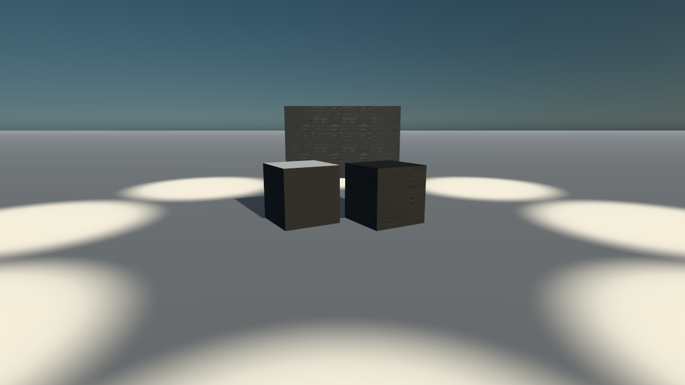

# The colours, everywhere: what the audit found and what the worlds look like

The design: `docs/superpowers/specs/2026-10-10-bf2017-colours-everywhere-design.md`. The session had no bucket key, so every number here is from the files on `main` at `e128ec47` (#371) and the roles already committed.

## The audit (`node scripts/bf2017-colour-check.mjs`)

Before the fix, over `public/models/galaxy/bf2017` (the packs hoth, sb_endor, sb_kamino, and fx):

| files | colour maps sRGB | colour maps linear (wrong) | data maps linear | data maps sRGB (wrong) | unknown |
| --: | --: | --: | --: | --: | --: |
| 907 | 132 | **180** | 588 | 0 | 7 |

The 180 are every UASTC-encoded `_cs` and `_c` map in the packs; the 132 sRGB ones are the ETC1S encodes. The seven unknown are `t_swatch_*` maps with no suffix; `--formats web/textures.jsonl` decides them (the plan's task 5). After `--fix`: 312 colour maps sRGB, 0 wrong. The 29 roles: whole (three maps each where the index says, every one credited EA DICE's).

## The worlds on the game's roles

`QUALITY=high` in software GL through `scripts/galaxy-check.mjs surface tatooine,endor,naboo`, the page's clock held and its random numbers seeded, so the two runs see the same world. `before-*.png` is `main` (the photo scans, `scans cc0 n game 0`); `after-*.png` is this branch (`siteOf`'s default `look.scanned: 'bf2017'`, `scans cc0 0 game n`). The counts (draw calls, triangles, textures, models MB) do not move: the roles are the same roles under the same `wear`/`dress`, only their files differ.

| world | before | after | scans fetched before → after |
| --- | --- | --- | --- |
| tatooine | `before/tatooine-high.jpg`: calls 94, tris 689,584, tex 303, models 26.1 MB | `after/tatooine-high.jpg`: calls 86, tris 689,352, tex 303, models 26.1 MB | cc0 47 → 0, game 3 → 39 |
| endor | `before/endor-high.jpg`: calls 216, tris 1,842,216, tex 330, models 14.5 MB | `after/endor-high.jpg`: calls 216, tris 1,842,216, tex 330, models 14.5 MB | cc0 49 → 0, game 2 → 42 |
| naboo | `before/naboo-high.jpg`: calls 507, tris 1,642,903, tex 456, models 26.3 MB | `after/naboo-high.jpg`: calls 506, tris 1,642,789, tex 455, models 26.3 MB | cc0 49 → 0, game 1 → 42 |

The after-run on `main`'s photo scans counted `game 1` to `3` already: the levels' probes and skies under `public/textures/galaxy/bf2017/light/`, which are not roles. The first after-run of Naboo counted one cc0 fetch: `/public/cc0/galaxy/index.json`, the set's index served by the dev server as a module import, not a map; the census now counts the maps themselves (`.webp`, `.ktx2`, `.png`, `.jpg`, `.avif`).

At this distance the grain is the same size on both sets (the roles' `metres` are the game's own, 2 to 6 m a tile), so the shots differ in the grain's character rather than its scale: look at the Tatooine homestead's walls and the ground by the ship, and Endor's trunks.

## The buckets, through the Supabase connector (2026-10-10, 22:55 UTC)

The owner attached a Supabase connector; the storage host itself stays refused by the environment's network policy, but the connector's SQL reads the storage catalogue (`storage.objects`: names and sizes, never bytes). Measured from it:

| bucket | objects | GB |
| --- | --: | --: |
| `bf2017-assets` `web/` (textures 28,277 at 21.85 GB; models 49,903; collision 12,941; physics 10,649; anims 8,074 + 2,196 additive; movies 161 at 5.73 GB; maps 264; terrain 111; svg 702; fonts 23) | 113,436 | 32.05 |
| `bf2017-assets` `data/` (the records) | 83,983 | 0.24 |
| `site-assets` (the published files, by hash) | 8,834 | 7.42 |

**Every published file answers.** All 1,246 entries of `src/data/galaxyAssets.json` are in `site-assets` at `<hash>/<path>` with exactly the manifest's bytes and `max-age=31536000`; the 492 published KTX2 maps among them. The mirror manifest (`assets-manifest.json`) is empty on this branch, so nothing of the site's own is served from the bucket. What SQL cannot tell is a published map's colour-space tag (the bytes are not in the database): `node scripts/bf2017-colour-check.mjs --published` does that once the host is reachable.

**The maps the packs wanted.** Hoth's `recipes.json` names 11 maps and the pack holds 10; the one it lacked at build, `T_StarCruiserMC80Panels_01_NS`, is still not in the bucket (no object under `web/textures/` matches `starcruisermc80panels_01` at 22:57 UTC): it is one of the 1,788 maps the desktop never encoded (lane D's list, `web_opt/_surfaces_list.tsv`). The space packs carry no `recipes.json` on `main`.

## The game's word (23:05 UTC, the bucket reachable)

`web/textures.jsonl` read: 17,511 rows, 17,374 distinct maps. Its `srgb` field is false on every row; the `format` is the word. By suffix, the game's own formats against the suffix rule (sRGB / linear):

| suffix | maps | sRGB | linear | the rule said |
| --- | --: | --: | --: | --- |
| `_cs` | 3,780 | 3,677 | 103 | colour |
| `_c` | 1,257 | 1,032 | 225 | colour |
| `_ca` | 287 | 285 | 2 | colour |
| `_d` | 98 | 82 | 16 | colour |
| `_co` | 77 | 77 | 0 | colour |
| `_nam` | 1,722 | 16 | 1,706 | data |
| `_n` | 1,215 | 5 | 1,210 | data |
| `_rgba` | 519 | 129 | 390 | data |
| `_m` | 383 | 164 | 219 | data |
| `_w` | 262 | 169 | 93 | data |
| `_aosl` | 272 | 9 | 263 | data |
| `_rgb` | 199 | 58 | 141 | data |
| (no suffix) | 2,331 | 256 | 2,075 | unknown |

So the format decides and the suffix rule is the fallback. Over the three packs with the game's word: 307 colour maps sRGB, 593 data maps linear, 7 unknown (swatches, not in the game's list); 21 maps the rule had called colour are linear in the game (`t_kam_cargometal_01_light_cs`, `t_kam_corridorlarge_wall2_01_cs` and `_e`, `t_kam_corridorlargerims_01_cs` and `_e`, among them) and are now stamped linear with the word in their pack rows. Every pack's `tex` row carries `srgb`: Hoth 51 sRGB and 98 linear, Hoth's recipes 4 and 6, Endor 37 and 77, Kamino 65 and 128 (2 unknown).

**Every published file answers** (`node scripts/assets-check.mjs`, 23:00 UTC): 1,246 of 1,246 right, 21.5 s. **Every published KTX2 says what it is** (`--published`): 492 files, 460 data maps linear, 32 unknown (the `_wm` weathering masks, the site's own fx sheets and sky maps), 0 wrong, 0 unreachable; the crew's published maps are all data (their colour maps are inside their GLBs).
# Lane colour: the variation chain

The sixth design's lane colour (`docs/superpowers/specs/2026-10-10-bf2017-accuracy-design.md`, §1.1 and §3; plan `docs/superpowers/plans/2026-10-10-bf2017-accuracy-lane-colour.md`). What the game binds a surface with is three records: the mesh variation databases (each mesh's textures by parameter name, once for the default and once per variation), the object variations (a shader preset, plain-named tints and switches) and the shader depots (the compiled parameters, their names hashed). This folder holds the measure: how much of what each pack draws is bound as the game binds it.

## The audit

`node scripts/bf2017-material-audit.mjs <world>…` (per world: `<world>.md` lists every material that is not `bound`, and why). A drawn material is `bound` when every slot its level's databases bind is drawn with that texture: the GLB's own (the export bound the dump's), or the variation's own map in the pack. `default-only`: the game varies the mesh on this level and the pack draws its default. `missing-texture`: a texture the database binds has no KTX2 in the bucket and the GLB does not carry it either. `no-entry`: no database of the level lists the mesh.

<!-- audit:start -->
| world | level | materials | bound | default-only | missing-texture | unbound | no-entry | bound share |
|---|---|---|---|---|---|---|---|---|
| `hoth` | `levels/mp/hoth_01` | 864 | 804 | 52 | 7 | 0 | 1 | 93.1 % |
| `sb_endor` | `levels/space/sb_endor_01` | 387 | 358 | 26 | 3 | 0 | 0 | 92.5 % |
| `sb_kamino` | `levels/space/sb_kamino_01` | 693 | 672 | 20 | 0 | 0 | 1 | 97.0 % |
<!-- audit:end -->

**The gate (Hoth ≥ 95 % bound) is not met: 93.1 %.** What is left is almost all `default-only`: 24 of Hoth's meshes are placed both plain and varied on the level (the crate `Box_M_01_A` snowed in the outdoor base, dry in the hangar; the wall lamps lit, off and red; the blankets thermal and padded). A pack draws one material per mesh, so those keep their default. The fix is a split by instance: the level's records already give every static instance its variation (`InstanceObjectVariation`, filled, not empty as the design thought: Hoth_01's 7 members and Content's 42 carry hashes), and `variations.json`'s `instances` keeps each group's list, but the pack builder (`scripts/bf2017-level.mjs`, lane E0's) keeps no group per instance. Once it does, the scene can draw a mesh's instances in more than one material and these 52 turn `bound`.

Counted `bound` and worth knowing: 92 of Hoth's materials bind a texture whose own KTX2 is not in the bucket (mostly `_MSW` and `_RGB` masks), but the dump binds the same one and the export baked it into the GLB (an `_MSW` into its ORM). Counted strictly the share would be 82.4 %.

## The writer and the reader

- `node scripts/bf2017-variations.mjs <world> [--fetch]` writes `variations.json` beside the pack (Hoth 0.40 MB) and a "Variations" table in its README. Hoth: 601 meshes, 55 with variations, 20 drawn in theirs (every instance agrees), 24 mixed, 0 by the level's rule (no mesh qualifies once instances are read), 105 textures the databases name and the bucket lacks. Endor: 210, 15, 2, 3. Kamino: 343, 16, 5, 6.
- `levelVariations.js` hands each varied mesh's recipes their variation; `variation.js` reads its vectors and conditionals through Q1's own parameter names (a lit lamp's colour-typed `EmissiveIntensety`, a container's `PaintColour`, a wreck's switch), `gameMaterial.js` draws a variation's own colour and normal maps in place of the GLB's and snows a snow variation from the start (Q4's snow at its whole amount). A recipe without one draws exactly as before (its test).
- On the site this is inert until `galaxy-surface` runs the node renderer (lane T), as Q1 is: the classic renderer keeps the GLB's materials.

## The fixture

`node scripts/light-fixture.mjs --materials --variations --legs webgl --size 1280x720`: Hoth's crate twice, as the dump has it and in `Box_M_01_A_Snow` (the mesh is mixed on Hoth, so the fixture names the variation), at high and ultra (`crate-<tier>-webgl.png`, the features in `variations-webgl.json`). SwiftShader is enough for a material's difference; the WebGPU leg is the owner's laptop. The crate's snow mask (`T_Box_M_01_A_M`) is not in the bucket, so the snow lies on every up-facing face, not only where the mask says.

On the shot the snowed crate's top is white and its sides are flatter than the plain crate's: the plain one draws no feature (`variations-webgl.json`: `(none)`), so it is the GLB's own material, while the snowed one goes through Q1's node graph, whose base on this crate reads flatter on SwiftShader. That is Q1's path for any material with a feature, not the variation's; worth a look on the laptop's WebGPU leg.

The regression (Q1's fixture without `--variations`, `--size 1280x720`): the GLB and low shots match the committed ones (mean difference 0.0001 of 255); mid and high differ by 0.4 to 0.5, from Q1's own later change to the characters' detail arrays (`d0faeedb`, after those shots were taken), not from this lane, whose code a recipe without a variation never enters (its unit test). The run was cut off before ultra and its JSON report.

## The dictionary

`node scripts/bf2017-shader-names.mjs` writes `src/data/bf2017/shaderParams.json`: 2,003 names (the material dump's keys, 2,801 object variations' parameter names, 139 shader presets'), each with its djb2-xor hash of the lower-cased name. The depot probe (`maps_work/shaderdepots.jsonl`) is not in the bucket; the desktop ran it (2026-10-11): 173,321 of 2,339,665 entries resolve (7.4 %), and 44.3 % of the 391,192 material-specific entries once the nine per-block engine constants (216,497 entries each) are set apart. 2,273 hashes stay unresolved: graph-internal names no record spells out. The gate's ≥ 90 % was written against the wrong denominator. The same hash names the variations: `VariationAssetNameHash` and an object variation's `NameHash` are `hashName` of its lower-cased path.

## The vehicles

`bf2017-import.mjs --variations <MVDB record>` binds a model's maps from its database by parameter name, by material index, where the GLB lacks them. It cannot retire #866's hand table: the materials whose graph binds their maps (the AT-AT's `SS_ATAT_Head`, the Falcon landmark's details, legs and windows) have empty entries in every database scanned (553 under `Gameplay/` and `Levels/`), and the other materials bind exactly what the dump does (AT-AT 15 of 15, Falcon 1 of 1). `--textures` stays.
