# The map, first half (endless universe, lane 6a)

The nav map and the mini-map as they are on `main`, before the lane changes them, and after, beside them. The plan is `docs/superpowers/plans/2026-10-18-endless-universe-lane-6a-map.md`.

## How the before shots were taken

- **When:** 2026-10-24.
- **What:** `main` at `cc5e2eaf` (“Merge pull request #1237”), served from a checkout of it by the server below, the fonts served too.
- **The check:** the lane’s `scripts/navmap-check.mjs` (its base URL and its `minimap` and `far` modes are the lane’s first commit), run against that server in all four modes, into a folder outside the repo, and the shots kept here copied in:

  ```
  BASE=http://127.0.0.1:5185 OUT=<a folder outside the repo> CHROME=<chromium> node scripts/navmap-check.mjs
  ```

- **The browser:** headless Chrome for Testing 153, WebGL in software (SwiftShader through ANGLE), `?quality=low`. Desktop 1440 × 900, phone 390 × 844 with touch, the flat map 1280 × 800.
- **The ship’s start:** `ship.js`’s `startAt()` picks one of its starts at random, so the ship opens somewhere else on each run: by Halcyon in `1-navmap` and `2-picked`, by The Lantern on the phone. Its marker and the panel’s first line move with it; the rest of the map doesn’t.

### The server, and the fonts

A checkout whose `node_modules` is a link to another folder, as the lane’s worktrees are, has a plain `npx vite` refuse the files it serves from there that aren’t modules. The fonts are such files: the two faces the site takes from `@fontsource`, Archivo (`archivo-latin-wdth-normal.woff2`) and JetBrains Mono’s 400 and 500 (each as `.woff2` and `.woff`), five files, each a 403 on every page load, and the words in those faces drawn in a fallback face. The first before shots were taken so, and showed the map’s labels in the wrong face. These were taken again with the fonts served.

The server is the checkout’s own `vite.config.js` with the linked folder allowed, from a throwaway config outside the repo. It keeps its own cache of optimised deps, beside it, so it doesn’t share the linked folder’s with another server:

```js
// vite.fs.config.mjs, anywhere outside the repo
import { realpathSync } from 'node:fs';
import { createRequire } from 'node:module';
import { basename, join } from 'node:path';
import { fileURLToPath, pathToFileURL } from 'node:url';

const root = process.cwd();
// (loaded as they are, not bundled into this file: vite from the checkout's node_modules)
const load = (file) => import(pathToFileURL(file).href);
const { mergeConfig, searchForWorkspaceRoot } = await load(createRequire(join(root, 'package.json')).resolve('vite'));
const { default: base } = await load(join(root, 'vite.config.js'));
export default mergeConfig(base, {
  cacheDir: fileURLToPath(new URL(`./vite-cache/${basename(root)}`, import.meta.url)),
  server: { fs: { allow: [searchForWorkspaceRoot(root), realpathSync(join(root, 'node_modules'))] } },
});
```

Run from the checkout:

```
npx vite --config <that file> --port 5185 --strictPort --host 127.0.0.1
```

Through it Archivo’s file comes back 200, not 403. The check prints every different page error, a failed load with its URL, and this run printed `no page errors`: its full list of errors is empty. The after shots are taken through the same server, from the lane’s worktree, so the before and after are drawn in the same faces, and Task 10’s `no page errors` can hold.

The check’s shots of the flights (`3-jumping`, `4-after-jump`, `6-super-to-aurelia`) and `5-charging` (the portal’s swirl over the chart, from the failed Citadel jump below) show nothing this lane changes, so they aren’t kept.

## Before and after

| Shot | What it shows | Before (`main`) | After |
| --- | --- | --- | --- |
| `1-navmap` | The map opened from the ship, desktop |  | 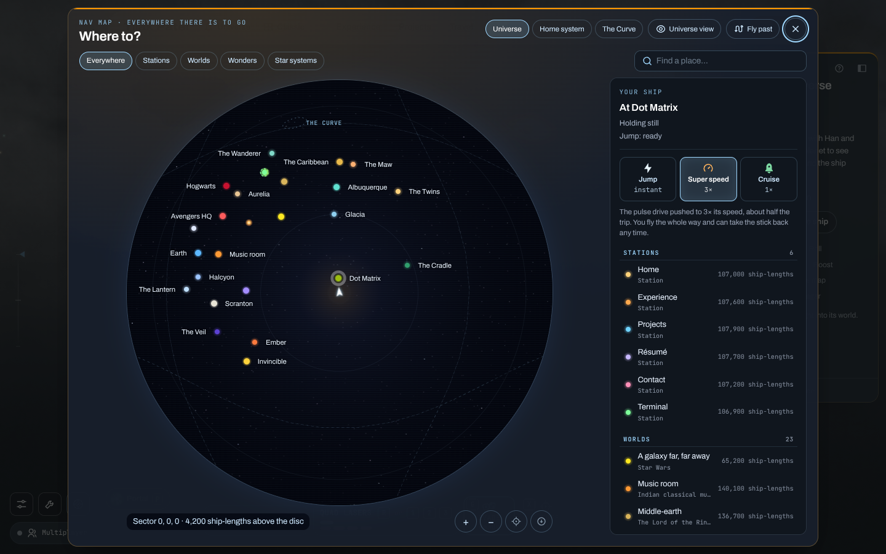 |
| `2-picked` | Avengers HQ picked, its course drawn |  | 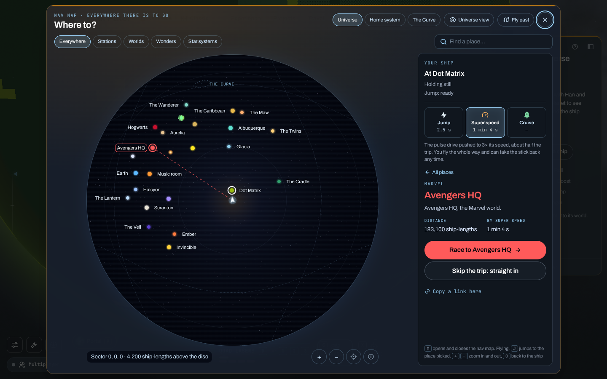 |
| `7-home-system` | The Home system chip, the ship elsewhere (below) |  | 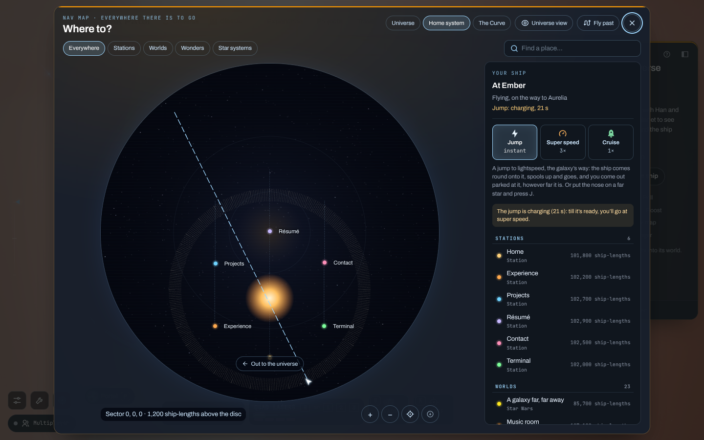 |
| `8-phone-map` | The universe on a phone, the map button |  | 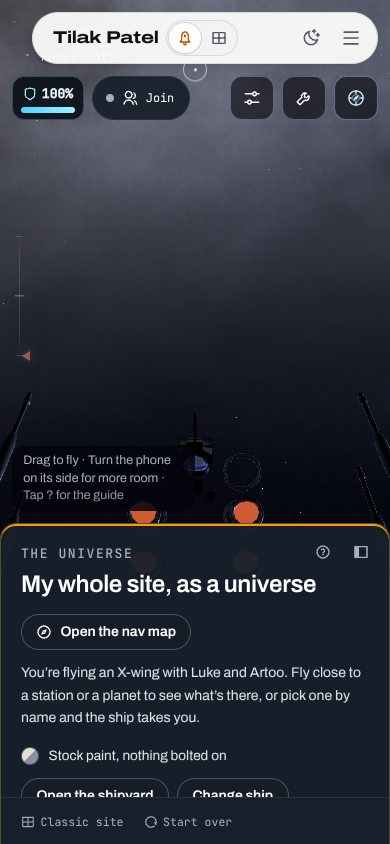 |
| `9-phone-navmap` | The map on a phone: the list first |  | 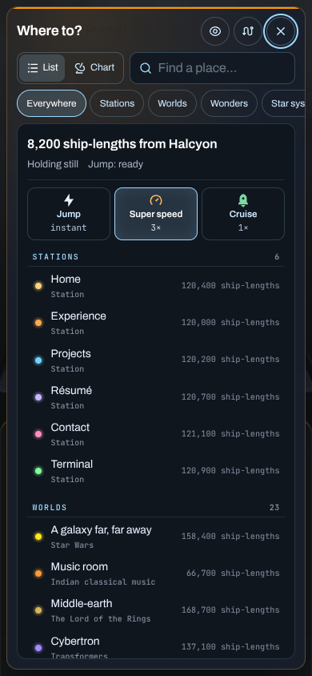 |
| `10-phone-picked` | Earth picked from the list |  | 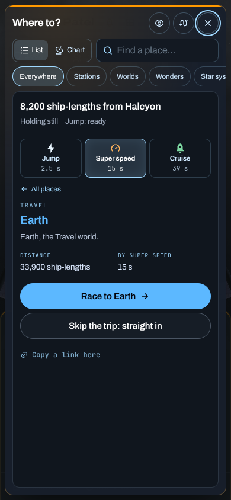 |
| `11-phone-chart` | The chart, a tap away, over the panel |  | 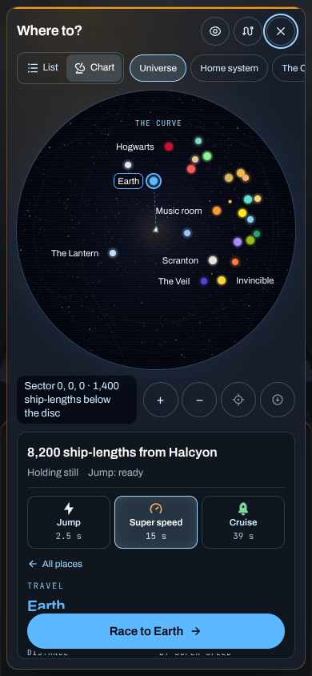 |
| `11-minimap-flat` | The flat map, with 3D off |  | 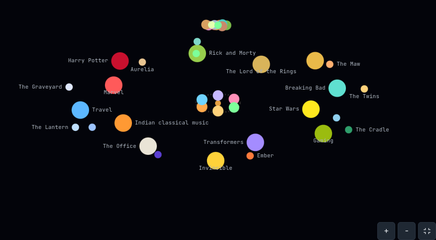 |
| `12-minimap-teaser` | Home’s teaser |  | 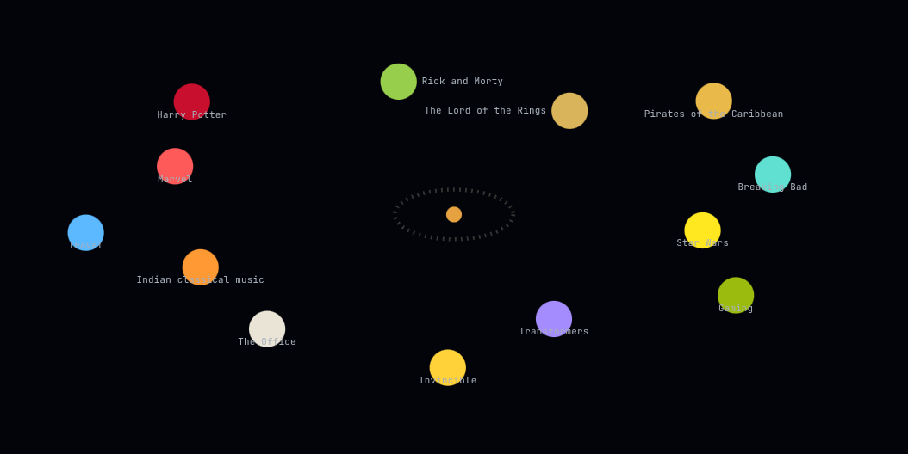 |
| `13-far-ship` | The ship two sectors out (x 250,000): no ship on the chart before, in its middle after |  | 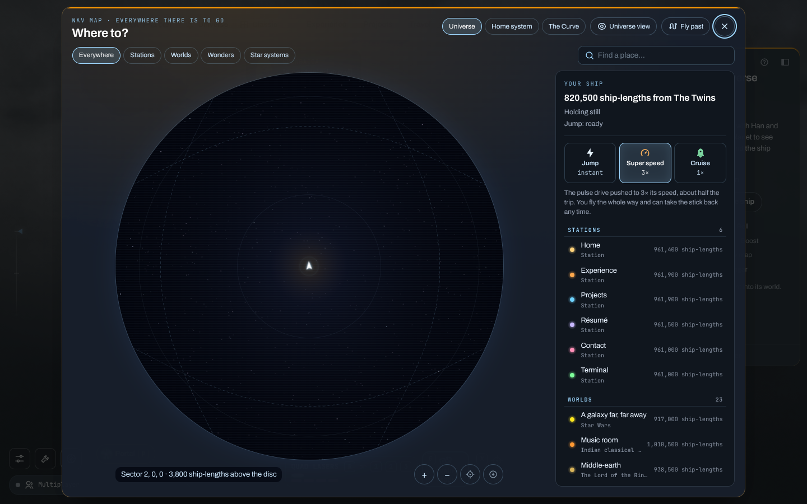 |
| `14-phone-zoomed` | The phone’s chart, zoom in tapped to a system | (none: `main`’s chart doesn’t zoom) | 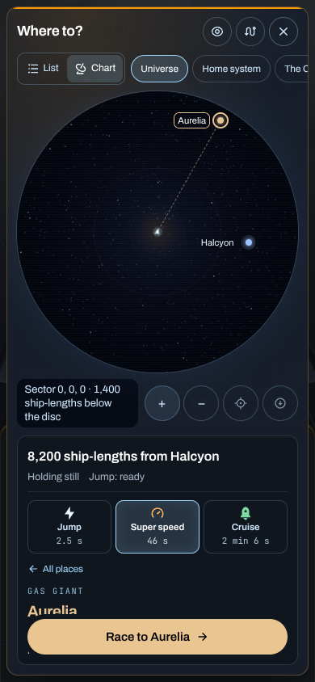 |
| `15-tilted` | The chart tilted by a Shift-drag, at the zoom it opens on | (none: `main`’s chart doesn’t tilt) | 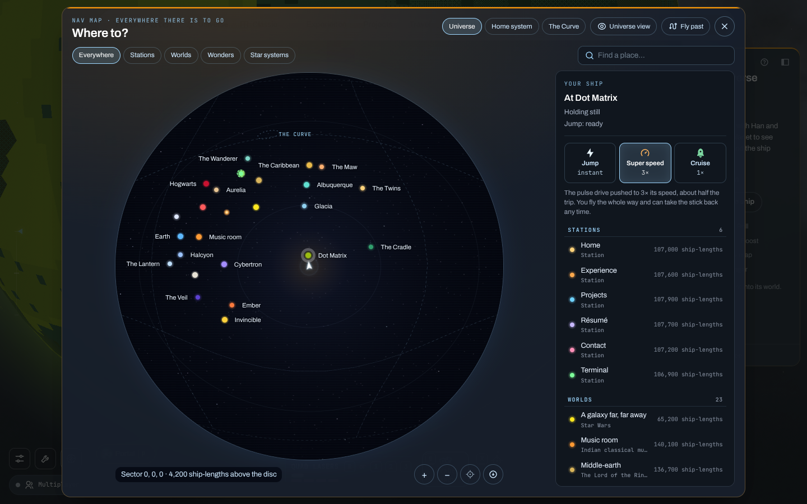 |
| `16-far-ship-pinned` | The ship two sectors out, the chart dragged off it: its marker pinned to the rim | (none) | 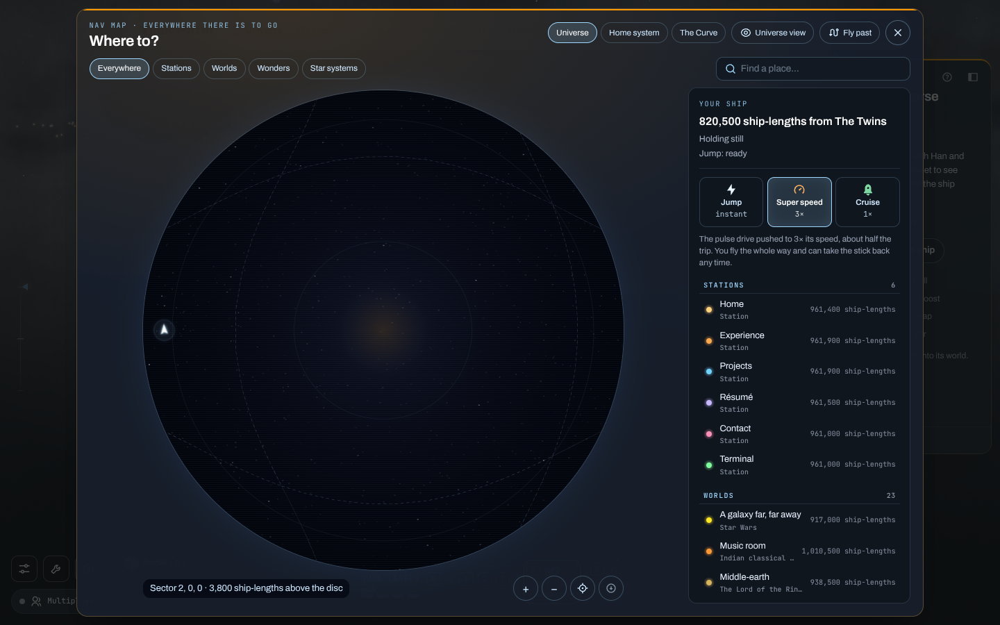 |
| `17-phone-sideways` | The map on a phone turned sideways (844 × 390) | (none) | 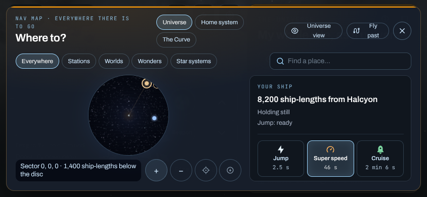 |
| `18-phone-minimap-flat` | The flat map on a phone, 3D off (below) | 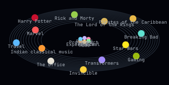 | 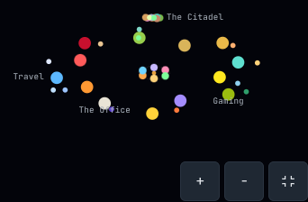 |

`7-home-system` was shot on `main` with the ship where the failed Citadel step (below) left it: in the Rick and Morty sector, 350 ship-lengths from The Citadel, on the pulse drive to Aurelia, the jump ready. So no ship marker is expected on the Home chart in the before shot. Once the Citadel step works, the after shot starts from another place, and the two won’t compare like for like there. After, the jump goes to Ember, and the ship is on its way from there to Aurelia at super speed, the jump charging: the Home system chip draws the six stations on their stems round the sun, and the ship, out past the chart’s edge, pinned to its rim with its course.

`18-phone-minimap-flat` was added in Task 9’s review and shot on `main` at `cc5e2eaf` the same way, by the check’s `minimap` mode at 390 × 844. On `main` the 3D-off map names every world on a phone, some names over others (Pirates of the Caribbean over The Lord of the Rings, the stations’ in a heap). After Task 9 it has all 44 places in that 342 px box. At first it named none at its opening zoom: no name had room clear of the other places’ dots, and a world’s name over a lesser dot would have put the world’s button over that dot. After the second review a place’s name lies under every button, so a world’s name may lie over a wonder’s or a moon’s dot where it has no other room, and that dot stays the wonder’s. The phone’s map now names four: The Office, Gaming, Travel and The Citadel. More won’t fit: with every dot let go, the names’ own boxes leave room for seven. The rest show for the pick, on a tap or a hover, and zoomed in. The desktop’s 19 names are the same 19 as before.

## How the after shots were taken

- **When:** 2026-10-24.
- **What:** the lane at `b5c1feb5` (Task 10’s check, on Tasks 1 to 9), served from its worktree by the same throwaway config as the before shots, on port 5184, the fonts served.
- **The check:** the same command, all four modes in one run (12 minutes), into `after/`:

  ```
  BASE=http://127.0.0.1:5184 OUT=docs/superpowers/evidence/endless-universe-6a-map/after CHROME=<chromium> node scripts/navmap-check.mjs
  ```

- **The browser:** as for the before shots.
- **The ship’s start:** at random again: at Dot Matrix (the Gaming world) on the desktop, 8,200 ship-lengths from Halcyon on the phone. The tilt is shot at the zoom the map opens on, before the wheel zooms it in. The flights’ shots (`3-jumping`, `4-after-jump`, `5-charging`, `6-super-to-aurelia`) aren’t kept, as before.

The chart is centred on the ship and opens 120,000 round it (a sector across), so the after shots name fewer far places than `main`’s whole-universe chart, and a place too far off isn’t on it: the chips and the wheel go out to the universe. `13-far-ship` and `16-far-ship-pinned` are the ship where `main` drew none.

## The checks on `main`

16 of 21 pass. The five that fail are the Citadel jump and the steps that run on from it. The Citadel is no longer at the check’s (1755, −4660) in the main sector: it sits in the Rick and Morty sector now (`deep.js`). So the go button offers the way through the portal (`NavMap.jsx`’s “… through the portal to”), not the jump, and the ship sets off on the pulse drive (HANDOFF-universe.md, “Left”).

- `FAIL the go button reads “Jump to The Citadel”`
- `FAIL the ship’s out at The Citadel on the first frame past the flash (null)`
- `FAIL the map says where you are and that the drive's charging` (it read “400 ship-lengths from The Portal Home · On the pulse drive, on the way to The Citadel · Jump: charging, 63 s”)
- `FAIL with the drive charging, it says so and goes at super speed`
- `FAIL still on its way out to Aurelia with the selection cleared (rmportal-back)`

The `far` mode says the ship’s marker is missing from the chart: `NavMap.jsx` draws the ship only in the chart’s own sector and inside its circle.

## The checks after

The whole run above: 50 of 51 pass, and no page errors.

The one that fails is `a trip time for every drive (2.5 s, 1 min 4 s, —)`: from where the ship started (at Dot Matrix, the Gaming world), the cruise to Avengers HQ is past the 150 s that `nav.js`’s `tripTime` flies, so it reads “—”. It depends on the start alone. Run on `nav.js`’s own `tripTime` from each of `ship.js`’s 32 starts (one side of each), 7 read “—” (by Gaming, Invincible, Ember, The Cradle and The Twins, and the beacons by The Maw and The Cradle). `nav.js` and `ship.js` are as on `main`, so `main` fails it from those starts too. Lane 6b’s formula for long trips (spec, F) is what mends it. It isn’t loosened here.

The desktop mode alone, run just before on the same code, passed all 29 of its checks with no page errors, its ship by A galaxy far, far away. Two other runs printed a page error that is the network’s, not the page’s: Home’s “Find me online” (`FindMeOnline.jsx`) asks GitHub’s API for the profile and was refused with a 403 (rate limit exceeded). `curl` from the same container is refused the same way.

The whole run’s output (the after-shots run):

```
ok   The Maw’s name clear of The Caribbean’s
ok   Glacia’s name clear of the galaxy gate’s
ok   no two names on the chart meet, and none runs off it
ok   the place list doesn’t run under the key hints
ok   on open the ship’s marker is in the middle of the chart (0.0 px off)
ok   the chart opens at the neighbourhood level (neighbourhood)
ok   the readout starts “Sector 0, 0, 0 · ” (Sector 0, 0, 0 · 4,200 ship-lengths above the disc)
ok   a Shift-drag up tilts the chart, and “Look straight down” is there to press (pitched true)
ok   “Look straight down” flattens it
ok   the wheel zooms the chart in to a system (7 turns)
ok   a minus typed in “Find a place…” goes in the field and doesn’t zoom (“-”, system)
ok   − zooms it back out to the neighbourhood (1 press)
ok   there’s a place’s button on the chart to drag from
ok   a drag 120 px right from gaming’s name takes the ship 120 px right with it (0.0 px off)
ok   the drag picks nothing and sends the ship nowhere (pressed false, autopilot null)
ok   “Back to the ship” is there to press once the chart’s moved
ok   “Back to the ship” puts it back in the middle (1.1 px off)
ok   the go button reads “Race to Avengers HQ”
FAIL a trip time for every drive (2.5 s, 1 min 4 s, —)
ok   the go button reads “Jump to Ember”
ok   the site’s jump plays over the map
ok   the ship’s out at Ember on the first frame past the flash ({"late":2.209000000001538,"frame":3.4166000000000736,"before":-1.2075999999985356})
ok   the world’s card is cleared from the panel (#/universe)
ok   the panel’s back to the map’s own
ok   the map says where you are and that the drive's charging (Your shipAt EmberHolding stillJump: charging, 65 s)
ok   with the drive charging, it says so and goes at super speed
ok   still on its way out to Aurelia with the selection cleared (aurelia)
ok   at 1280 × 500 the chart, its bar and the side panel are all on the screen
ok   Escape closes the map
ok   the map button fits on a phone, clear of the settings, the hangar and the pilots
ok   on a phone it opens on the list, every row 44 px or more ({"mode":"list","frame":true,"chart":false,"rows":89,"low":44.265625})
ok   the go button’s on the screen
ok   the chart sits over the panel, all on the screen ({"chart":true,"side":true})
ok   on a phone too, no two names meet
ok   with the chart up, the go button’s still on the screen
    names showing on the phone’s chart: 8 of 27 (Music room, Scranton, Earth, Invincible, Hogwarts, The Veil, The Lantern, The Curve)
ok   on a phone each chart tool is 44 px or more, inside the frame and clear of the others and the readout (in 44×44, out 44×44, ship 44×44, flat 44×44)
ok   the readout shows on a phone
ok   the side panel under the chart scrolls ({"tall":466,"shows":282,"moved":184})
ok   a wonder on the phone’s chart has its name hidden (Aurelia)
ok   Aurelia’s name shows on the chart once it’s picked from the list
ok   tapping zoom in takes the chart from the neighbourhood level to the system (7 taps)
ok   turned sideways (844 × 390), the frame, the chart, its bar and the side panel’s top are all on the screen
ok   the flat map has Aurelia, The Veil and a moon, Squanch, and no orbit rings (0 rings)
ok   the flat map has a world with a lesser place’s button beside its dot
ok   a pointer over veil, then a click on office’s dot beside it, picks office (office)
ok   + with the focus on the flat map zooms it from the neighbourhood level to the system (6 presses)
ok   Home’s teaser has only worlds on it (13)
ok   the flat map on a phone names a place at its opening zoom (office, gaming, travel, citadel)
ok   two sectors out, the ship’s marker is on the chart, inside its circle ({"drawn":true,"inside":true,"edge":false,"readout":"Sector 2, 0, 0 · 3,800 ship-lengths above the disc"})
ok   the readout says the ship’s sector, 2 out (Sector 2, 0, 0 · 3,800 ship-lengths above the disc)
ok   dragged 400 px left, the ship’s marker is pinned to the rim, inside the circle ({"drawn":true,"inside":true,"edge":true,"readout":"Sector 2, 0, 0 · 3,800 ship-lengths above the disc"})
no page errors
1 FAILED
```

The jump’s timing reads each frame by the time it began (its `requestAnimationFrame` timestamp): here a frame takes seconds to draw, and the time the log ran at could be past the flash in a frame the scene had stepped before it. Read so, the frame before the ship came out began 1.2 s before the flash, and the ship was out on the next.

## The phone layout

HANDOFF-universe.md’s “Left” had the phone layout “tightened in CSS and never seen in a browser”. Seen now, at 390 × 844 with touch and the `(pointer: coarse)` rules on (Chromium won’t emulate the pointer, so the check turns them on itself):

| What “Left” asked | Seen |
| --- | --- |
| The chart over the side panel | On the screen, the panel under it and the go button held at its foot (`11-phone-chart`). |
| The panel’s scroll | 466 px of panel in 282 px; it scrolls (to 184 px, its end). |
| Wonder names hidden unless picked | No rule hides a wonder’s name on a phone any more (`main`’s went with `chartLabels.js`): a name with no room is left off and shows for the pick. Aurelia’s was off on the phone’s chart, and showed once it was picked from the list. |
| The map button clear of the Multiplayer pill | Kept (`8-phone-map`). |

And the chart’s own, new: its four tools are 44 × 44, inside the frame, clear of each other and of the readout; the readout shows every word (three lines at 390 px); seven taps on zoom in take it from the neighbourhood to a system (`14-phone-zoomed`); turned sideways (844 × 390) the frame, the chart, its bar and the side panel’s top are all on the screen (`17-phone-sideways`). At 844 px the map is the desktop’s two columns, so the chart there is 165 px across, and the way out, on the Home system’s chart, covers a good part of it. A desktop window 1280 × 500 fits too.

The phone’s chart names few of its places: 8 of 27 in the run above, 5 of 27 in the one before (with Earth picked, as `main`’s `11-phone-chart` named 17). Measured on a stand-in page (the real `NavMap` with a fake `where()`, not committed), the ship at the home system’s edge with nothing picked: 5 named at 390 × 844 (a 348 px chart), 10 at 820 × 900 (398 px) and 22 at 1440 × 900 (691 px). The names keep clear of every other place’s 16 px dot in a 24 px box, and a phone’s chart is a quarter of the desktop’s area. More names on a phone is the owner’s call (Task 8’s “Left”: `labelSize`’s box is the knob).

## The other checks that read the nav map

Each run on the lane's server and, where a step failed, on `main`'s (a checkout of `cc5e2eaf` served the same way). `sector-check`, `wonders-check` and `links-check` ask for `localhost:5173` in their code, so `main` was served on another port and they ran from copies with that port changed, nothing else. None of these steps is the lane's: each that fails on the lane fails on `main` too, or is a flight or battle step that waits a fixed few seconds for frames that come seconds apart here, through files the lane doesn't change (`scene.js`, `ship.js`, `nav.js`, `portals.js`, `front.js`, `battle.js`, `battleScene.js`).

| Check | The nav map's steps | The lane | `main` |
| --- | --- | --- | --- |
| `sector-check.mjs` (the cruiser) | “the nav map opens on the sector's chart” (The Curve pressed): ok on both | 8 ok, 4 fail: going on to Gazorpazorp from the far side, the crew out on Gazorpazorp, back through into the main map, and home (39 minutes, no errors) | 7 ok, 5 fail: the same four, and at the Citadel (43 minutes, no errors) |
| `universe-war-check.mjs cruiser low` | “the nav map draws the war's seven sectors”: ok on both. “the nav map's front button sends the autopilot there”: fails on both | 7 ok, 4 fail, twice: phase 2, the reactor, the war moved on, the front button (no page errors). A first run had no front 2.5 s after the scene started, under the other runs' load | 8 ok, 3 fail: the reactor, the war moved on, the front button (no page errors). A first run had no front, as on the lane |
| `wonders-check.mjs` | each wonder picked from the nav map's list and gone to by its go button | As its header has it, no WebGL: it asks for `--use-gl=swiftshader`, which this Chromium no longer has, so the scene never starts (180 s). Through ANGLE's SwiftShader instead (a wrapper round the browser, as `navmap-check` launches it), with Ember, Halcyon and The Maw: Ember and Halcyon ok, The Maw parked 675 out (its reach 500, the check's 580) | The same, through the same wrapper: Ember and Halcyon ok, The Maw parked 675 out |
| `links-check.mjs` | the Star systems kind, Hoth picked, the go button, Fly past | As its header has it, no WebGL, as `wonders-check`. Through the wrapper: the link out to Aurelia (2 ok), then “nothing at .universe-navmap-btn”: it clicks the map button 2 s after the scene starts, and in software GL the button comes once the shaders are in, minutes later | The same, through the same wrapper, at the same step |

The phase 2 step waits 3 s after the generators are hit for the battle to step, and in software GL a frame can take longer: it passed in `main`'s run and failed in both of the lane's, through battle files the lane doesn't change. The front button's step reads `state.auto`, and with the jump ready the scene's `travel` sets `state.jump` (Task 8's hand-off notes); `main` fails it the same way. The Maw's park is at the edge of its pull (`nav.js`'s `parkFor`), past the check's reach and 80.

## The scene

`scene.js`, `ship.js`, `nav.js` and the generator are as on `main` (`git diff cc5e2eaf` on them is empty; `layout.js` changed a comment). The chart and the mini-map are the page’s DOM and SVG over the scene’s canvas, so the scene’s draw calls and triangles are as on `main`. They weren’t measured again here.

## The mini-map’s bundle (Task 9)

The mini-map now reads the nav map’s own marks (`chart/marks.js`, from `nav.js`), its projection and its hook, so Home’s lazy section (`Interests`) loads them too. Built with `npx vite build` (the plain build, without `prebuild`’s GitHub snapshot) on Task 8’s commit (`5c76fb0b`) and on Task 9’s, Vite’s report for the two chunks, and the whole of what `Interests` loads that the first page and Home don’t (its chunk and the static imports under it, read from the built files):

| | Task 8 (`5c76fb0b`) | Task 9 | Task 9’s first review (`d04e23c3`) | Task 9’s second review |
| --- | --- | --- | --- | --- |
| `Interests` chunk | 7.41 kB (gzip 2.90 kB) | 7.41 kB (gzip 2.91 kB) | 7.41 kB (gzip 2.91 kB) | 7.41 kB (gzip 2.90 kB) |
| `MiniMap` chunk | 2.62 kB (gzip 1.30 kB) | 4.20 kB (gzip 2.11 kB) | 4.68 kB (gzip 2.33 kB) | 4.24 kB (gzip 2.16 kB) |
| Home’s lazy section, all of it | 24.70 kB (gzip 10.71 kB), 4 files | 55.22 kB (gzip 24.80 kB), 9 files | 55.73 kB (gzip 25.02 kB), 9 files | 48.54 kB (gzip 21.73 kB), 7 files |

The five new files are `nav.js` (9.74 kB), the chart’s modules and hook (16.57 kB), the gesture reader (1.20 kB), the universe’s glossary (1.16 kB) and an icon. `ship.js` was already in the first page’s load, so it adds nothing here.

After the second review the 3D-off map’s hands, keys and tools are `FlatMap.jsx`’s, and `MiniMap.jsx` only draws, so the teaser no longer loads the hook, `input.js`, `ChartTools`, the gesture reader or the icon. What it still loads past Task 8 is the data and the drawing: `nav.js` (9.74 kB), the marks and the projection (14.33 kB) and `place.js` with `declutter.js` (11.32 kB, its own chunk now: before, it was inside the hook’s). The last two columns were built the same way from the worktree, `src` as at each commit, and the whole section read from Vite’s manifest (`build.manifest`): each file `Interests` imports, on down, less those the entry and `Home.jsx` load, gzipped by Node at its default level.
