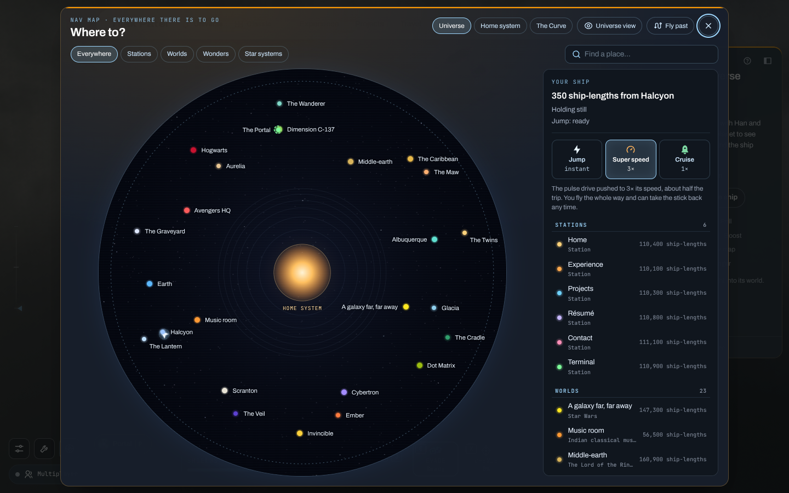
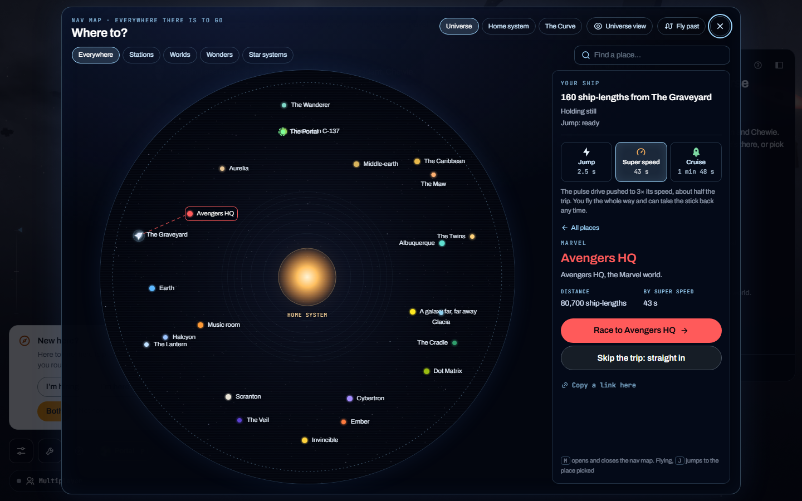
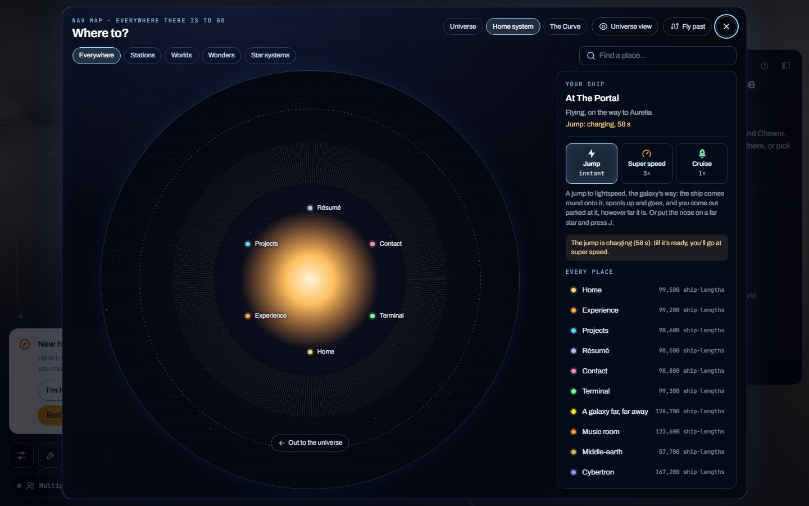
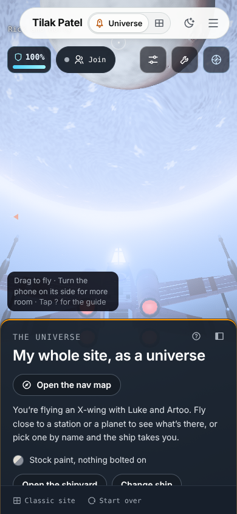
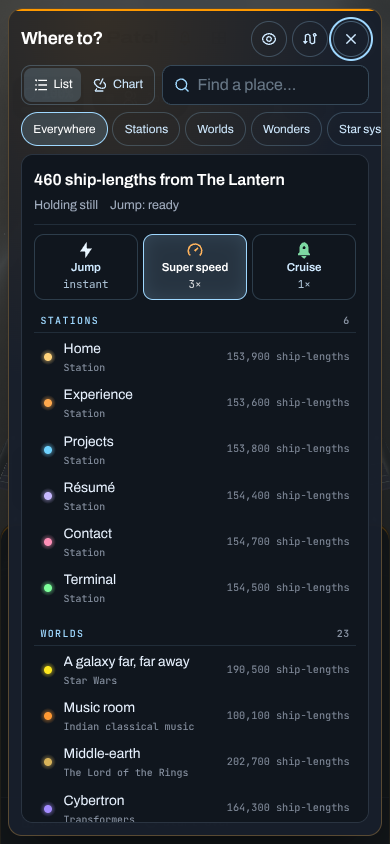
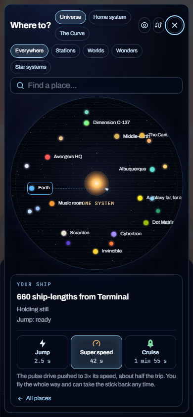
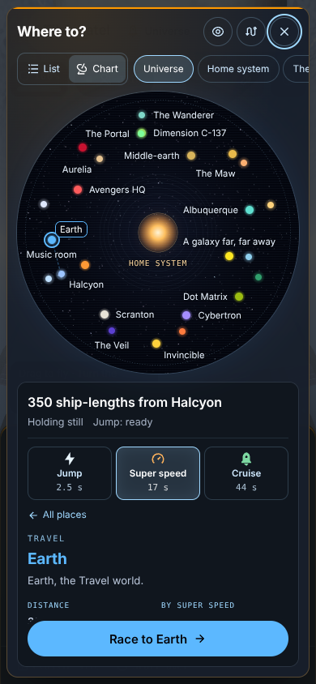
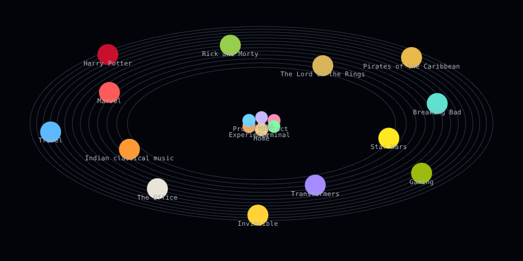
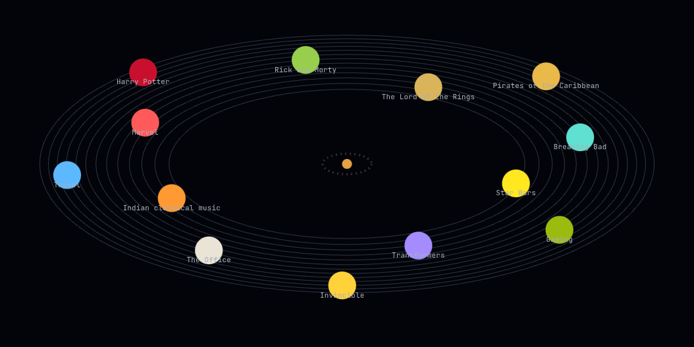
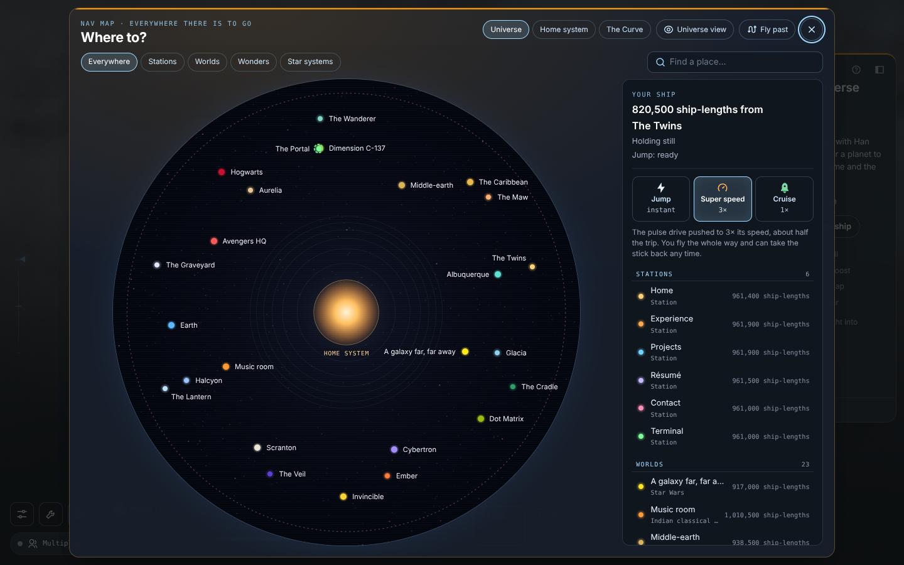

# The map, first half (endless universe, lane 6a)

The nav map and the mini-map as they are on `main`, before the lane changes them, and after, beside them. The plan is `docs/superpowers/plans/2026-10-18-endless-universe-lane-6a-map.md`.

## How the before shots were taken

- **When:** 2026-10-24.
- **What:** `main` at `cc5e2eaf` (“Merge pull request #1237”), served from a checkout of it by the server below, the fonts served too.
- **The check:** the lane’s `scripts/navmap-check.mjs` (its base URL and its `minimap` and `far` modes are the lane’s first commit), run against that server in all four modes, into a folder outside the repo, and the shots kept here copied in:

  ```
  BASE=http://127.0.0.1:5185 OUT=<a folder outside the repo> CHROME=<chromium> node scripts/navmap-check.mjs
  ```

- **The browser:** headless Chrome for Testing 153, WebGL in software (SwiftShader through ANGLE), `?quality=low`. Desktop 1440 × 900, phone 390 × 844 with touch, the flat map 1280 × 800.
- **The ship’s start:** `ship.js`’s `startAt()` picks one of its starts at random, so the ship opens somewhere else on each run: by Halcyon in `1-navmap` and `2-picked`, by The Lantern on the phone. Its marker and the panel’s first line move with it; the rest of the map doesn’t.

### The server, and the fonts

A checkout whose `node_modules` is a link to another folder, as the lane’s worktrees are, has a plain `npx vite` refuse the files it serves from there that aren’t modules. The fonts are such files: the two faces the site takes from `@fontsource`, Archivo (`archivo-latin-wdth-normal.woff2`) and JetBrains Mono’s 400 and 500 (each as `.woff2` and `.woff`), five files, each a 403 on every page load, and the words in those faces drawn in a fallback face. The first before shots were taken so, and showed the map’s labels in the wrong face. These were taken again with the fonts served.

The server is the checkout’s own `vite.config.js` with the linked folder allowed, from a throwaway config outside the repo. It keeps its own cache of optimised deps, beside it, so it doesn’t share the linked folder’s with another server:

```js
// vite.fs.config.mjs, anywhere outside the repo
import { realpathSync } from 'node:fs';
import { createRequire } from 'node:module';
import { basename, join } from 'node:path';
import { fileURLToPath, pathToFileURL } from 'node:url';

const root = process.cwd();
// (loaded as they are, not bundled into this file: vite from the checkout's node_modules)
const load = (file) => import(pathToFileURL(file).href);
const { mergeConfig, searchForWorkspaceRoot } = await load(createRequire(join(root, 'package.json')).resolve('vite'));
const { default: base } = await load(join(root, 'vite.config.js'));
export default mergeConfig(base, {
  cacheDir: fileURLToPath(new URL(`./vite-cache/${basename(root)}`, import.meta.url)),
  server: { fs: { allow: [searchForWorkspaceRoot(root), realpathSync(join(root, 'node_modules'))] } },
});
```

Run from the checkout:

```
npx vite --config <that file> --port 5185 --strictPort --host 127.0.0.1
```

Through it Archivo’s file comes back 200, not 403. The check prints every different page error, a failed load with its URL, and this run printed `no page errors`: its full list of errors is empty. The after shots are taken through the same server, from the lane’s worktree, so the before and after are drawn in the same faces, and Task 10’s `no page errors` can hold.

The check’s shots of the flights (`3-jumping`, `4-after-jump`, `6-super-to-aurelia`) and `5-charging` (the portal’s swirl over the chart, from the failed Citadel jump below) show nothing this lane changes, so they aren’t kept.

## Before and after

| Shot | What it shows | Before (`main`) | After |
| --- | --- | --- | --- |
| `1-navmap` | The map opened from the ship, desktop |  | |
| `2-picked` | Avengers HQ picked, its course drawn |  | |
| `7-home-system` | The Home system chip, the ship elsewhere (below) |  | |
| `8-phone-map` | The universe on a phone, the map button |  | |
| `9-phone-navmap` | The map on a phone: the list first |  | |
| `10-phone-picked` | Earth picked from the list |  | |
| `11-phone-chart` | The chart, a tap away, over the panel |  | |
| `11-minimap-flat` | The flat map, with 3D off |  | |
| `12-minimap-teaser` | Home’s teaser |  | |
| `13-far-ship` | The ship two sectors out (x 250,000): no ship on the chart |  | |

`7-home-system` was shot on `main` with the ship where the failed Citadel step (below) left it: in the Rick and Morty sector, 350 ship-lengths from The Citadel, on the pulse drive to Aurelia, the jump ready. So no ship marker is expected on the Home chart in the before shot. Once the Citadel step works, the after shot starts from another place, and the two won’t compare like for like there.

## The checks on `main`

16 of 21 pass. The five that fail are the Citadel jump and the steps that run on from it. The Citadel is no longer at the check’s (1755, −4660) in the main sector: it sits in the Rick and Morty sector now (`deep.js`). So the go button offers the way through the portal (`NavMap.jsx`’s “… through the portal to”), not the jump, and the ship sets off on the pulse drive (HANDOFF-universe.md, “Left”).

- `FAIL the go button reads “Jump to The Citadel”`
- `FAIL the ship’s out at The Citadel on the first frame past the flash (null)`
- `FAIL the map says where you are and that the drive's charging` (it read “400 ship-lengths from The Portal Home · On the pulse drive, on the way to The Citadel · Jump: charging, 63 s”)
- `FAIL with the drive charging, it says so and goes at super speed`
- `FAIL still on its way out to Aurelia with the selection cleared (rmportal-back)`

The `far` mode says the ship’s marker is missing from the chart: `NavMap.jsx` draws the ship only in the chart’s own sector and inside its circle.

## The mini-map's bundle (Task 9)

The mini-map now reads the nav map's own marks (`chart/marks.js`, from `nav.js`), its projection and its hook, so Home's lazy section (`Interests`) loads them too. Built with `npx vite build` (the plain build, without `prebuild`'s GitHub snapshot) on Task 8's commit (`5c76fb0b`) and on Task 9's, Vite's report for the two chunks, and the whole of what `Interests` loads that the first page and Home don't (its chunk and the static imports under it, read from the built files):

| | Task 8 (`5c76fb0b`) | Task 9 |
| --- | --- | --- |
| `Interests` chunk | 7.41 kB (gzip 2.90 kB) | 7.41 kB (gzip 2.91 kB) |
| `MiniMap` chunk | 2.62 kB (gzip 1.30 kB) | 4.20 kB (gzip 2.11 kB) |
| Home's lazy section, all of it | 24.70 kB (gzip 10.71 kB), 4 files | 55.22 kB (gzip 24.80 kB), 9 files |

The five new files are `nav.js` (9.74 kB), the chart's modules and hook (16.57 kB), the gesture reader (1.20 kB), the universe's glossary (1.16 kB) and an icon. `ship.js` was already in the first page's load, so it adds nothing here.
