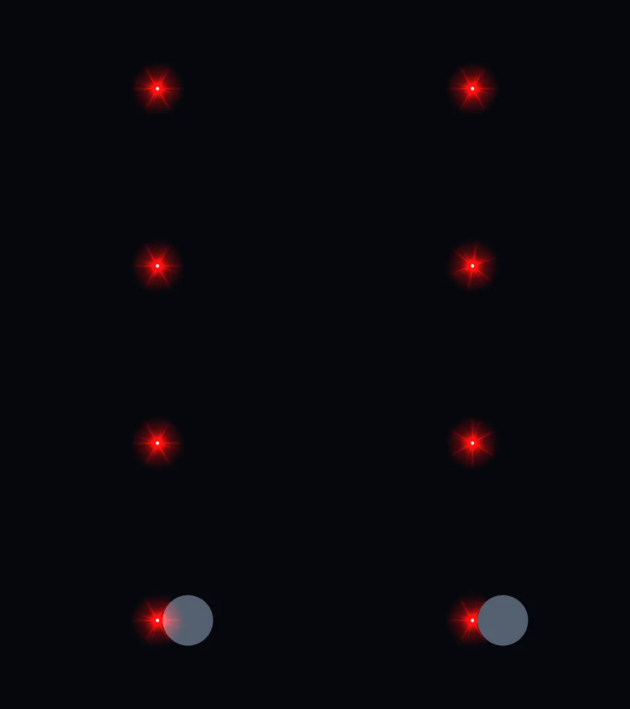
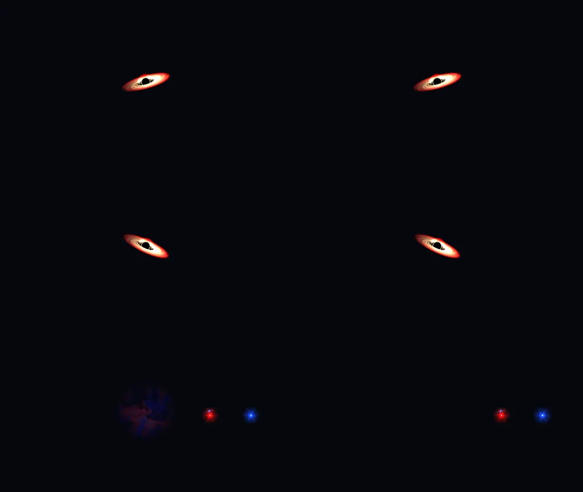
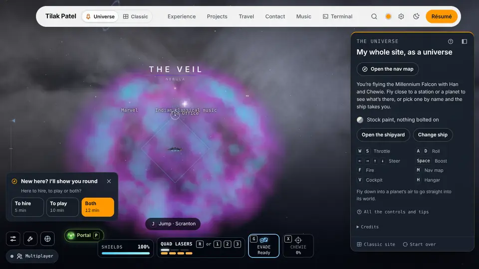
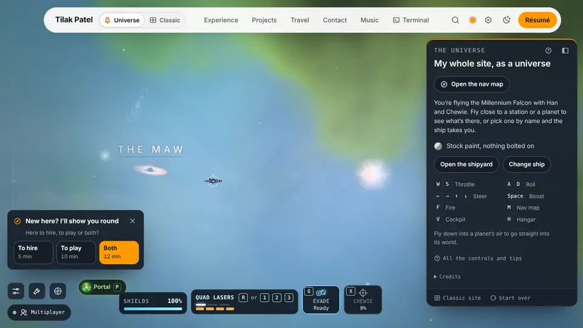

# Endless universe, lane 1: nebulae and the sky

The lane’s numbers, before and after. Plan: `docs/superpowers/plans/2026-10-18-endless-universe-lane-1-nebulae.md`. Spec: `docs/superpowers/specs/2026-10-18-endless-universe-design.md` (section D, and item 5 of “What done looks like”).

## Task 1: the before

### Where the before comes from

The lane lands on top of lane 2, so its before is the tip it starts from, not `main`. `eu/lane-1` starts at `ebfb2307`, lane 2’s PR 2.4 task 16: camera-relative drawing (PR 2.3), the budget table, the levels, the far layer, the discs and the nearest systems. Nothing of this lane’s is in it.

- **The lane’s before:** `node scripts/universe-check.mjs --quality mid --frames 3 --out lab/universe/lane1-before/mid`, run at `ebfb2307` on 2026-10-25 (exit 0, every pose ok, no page error). Mid only: the coordinator’s browser budget gives a lane one tier, and runs every tier once at the end. The numbers are `before-mid.json`; the overview pose’s shot is `before-universe.webp`.
- **`main` beside it:** the coordinator’s run of every tier at `cc5e2eaf` (`node scripts/universe-check.mjs --quality all --frames 3`), copied as `main-{high,mid,low}.json`. They show what lane 2 moved before this lane starts.

### Calls and triangles a pose

A whole frame’s draw calls and triangles from `renderer.info`, at 1280 × 720. The ten poses without a mark are `lab/universe/baseline/high.json`’s keys; † marks the other four that `universe-check.mjs` measures.

| pose | main high calls | main high tris | main mid calls | main mid tris | main low calls | main low tris | lane mid calls | lane mid tris |
| --- | --: | --: | --: | --: | --: | --: | --: | --: |
| `overview` | 98 | 540,628 | 99 | 489,042 | 63 | 476,702 | 98 | 488,962 |
| `falcon-sun` | 82 | 525,686 | 82 | 474,020 | 54 | 465,188 | 82 | 474,020 |
| `middleearth-limb` | 39 | 106,406 | 39 | 37,732 | 24 | 8,850 | 39 | 37,732 |
| `rickmorty` | 39 | 91,688 | 40 | 38,858 | 40 | 33,864 | 40 | 38,858 |
| `gaming` | 40 | 59,034 | 43 | 45,466 | 26 | 10,842 | 43 | 45,466 |
| `caribbean` | 43 | 156,166 | 43 | 87,492 | 22 | 8,834 | 43 | 87,492 |
| `belt` | 46 | 465,860 | 46 | 421,298 | 28 | 415,134 | 46 | 421,298 |
| `maw` | 43 | 77,372 | 43 | 74,250 | 27 | 8,854 | 43 | 74,250 |
| `landing-middleearth` | 129 | 181,875 | 116 | 126,980 | 116 | 126,662 | 77 | 50,796 |
| `station` | 69 | 510,880 | 69 | 459,214 | 69 | 456,836 | 69 | 459,214 |
| `middleearth` † | 39 | 106,406 | 39 | 37,732 | 17 | 4,002 | 39 | 37,732 |
| `breakingbad` † | 63 | 92,994 | 64 | 31,930 | 25 | 8,850 | 64 | 31,930 |
| `office` † | 41 | 62,606 | 41 | 23,236 | 41 | 18,242 | 41 | 23,236 |
| `far-rim` † | 42 | 85,160 | 42 | 40,598 | 39 | 36,198 | 42 | 40,598 |

The lane’s mid column matches `main`’s mid at every pose but two:

- **`overview`:** one call and 80 triangles fewer, from lane 2’s commits.
- **`landing-middleearth`:** 77 calls and 50,796 triangles against `main`’s 116 and 126,980. The lane’s shot (`lab/universe/lane1-before/mid/landing-middleearth.webp`) is bare brown ground under a dusk sky, with no smial, no trees and no green; `main`’s has all three. Its frames took 8.7 s against `main`’s 4.1 s, so the landing’s things may not have loaded before the measure (a race), or lane 2’s branch lost them. It isn’t this lane’s to fix, and the lane changes nothing a landing draws before Task 7. In Task 11, a landing that has its things again is read against `main`’s mid column, not this one.

The after goes beside the lane’s mid column in Task 11. A pose over its before there is a stop (the plan’s Task 11, step 2).

### The counts

| | before | the plan’s figure (2026-10-18) |
| --- | --: | --: |
| `wc -l src/components/universe/scene.js` | 6,374 | 6,226 |
| `glsl-sites` (budget 619) | 614 | 607 |
| `big-files` (budget 30) | 22 | 30 |

`scene.js` was 6,409 lines on `main` at `cc5e2eaf`; lane 2’s PR 2.3 took it to 6,374, and the lane’s net is measured from there. `glsl-sites` and `big-files` are `node scripts/health.mjs --only glsl-sites,big-files` at `ebfb2307`. The lane adds at most two `ShaderMaterial` sites in `nebula/` and takes out two, so `glsl-sites` ends at 614 or lower.

### Not taken here

- **Frame times** (`perf-probe.mjs universe`, twice a tier for the noise floor). Headless Chromium draws in software at a frame or two a second, so its frame times say little, and the browser budget leaves the timing to the coordinator’s measure at the end. The before can be taken again at any commit before Task 7, the first that changes what the map draws (Tasks 2 to 6 add pure files, a renderer nothing calls yet and a sky option that defaults to today’s bake).
- **The two route shots** (`autopilot-check.mjs --routes /universe` and `--routes /galaxy`, with `--before`). The overview pose stands for `/universe`. `/galaxy`’s before, which Task 11 compares pixel for pixel, can be shot at any commit before Task 6, the first to touch the galaxy’s sky (`src/components/galaxy/sky.js`); until then the galaxy is as `ebfb2307` has it.

## Task 7: the landmarks

The first task that changes what the map draws. The landmarks’ quad stands upright in the world (its up the map’s +y, `quadAxes`) and tests depth. The Veil and the Cradle are no longer drawn as landmarks. Deep space’s own clouds stand for them until Task 8 hands them to `nebula/`.

### The shader, compiled and drawn

Node can’t compile GLSL, so the landmarks were drawn alone in headless Chromium (software GL) at 960 × 540 through a 12° lens. The lab page and its script are `lab/landmarks/index.html` and `shot.mjs`, git-ignored. `main`’s `landmarks.js` (`cc5e2eaf`) is on the left of each sheet, this branch’s on the right.

- **The new program links:** no console error, `gl.getError()` 0 at every pose.
- **The one 404:** each run logs a single resource 404 on whichever page loads first, so it’s the browser’s own request, not either module.
- **The draw:** one call either way. The draw is 8 instances and 16 triangles, against 10 and 20.

`task7-stars.webp`, top to bottom:

1. **Level:** the same.
2. **Rolled 0.7 rad:** `main`’s rays stay where the screen has them. The branch’s turn with the roll, as the stars do.
3. **Straight overhead:** drawn whole, no NaN.
4. **A ball in front, drawn first:** `main`’s glare paints over it. The branch’s is hidden behind it.

`task7-maw-veil.webp`:

- **The Maw, level and rolled:** the same on both sides. Its disk was already read from its axis in the view, and it is now read in the quad’s own basis.
- **The Veil from 30,000 out:** `main` draws its painted cloud. The branch draws none, since the Veil is `nebula/`’s now.

### The counts after Task 7

- `wc -l src/components/universe/scene.js`: 6,374, unchanged. The landmarks call lost its `renderer`, `small` and `level`; the comment stayed two lines.
- `glsl-sites`: 616 after Tasks 4 and 5, now 615. The atlas’s paint material is gone.
- `big-files`: 22, unchanged.

## Task 8: deep space and the sky, wired

Deep space owns the one renderer (`nebula/`) and hands it the Veil and the Cradle; the puffs, their texture, the young stars’ `Points` and their four shaders are gone. The map’s sky is `mapSky.js`, baked with `clouds: false`. `paceTo` tells the renderer the quality step (`setLevel`), which the index plan had handed on to lane 2.

### Looked at

The map at mid in headless Chromium (software GL), 1280 × 720, through `lab/lane1-t8/look.mjs` (git-ignored): the ship held as a pose holds it, the camera set where asked, six frames, then the renderer read and a shot taken.

- **The programs link before the first frame.** Both nebula materials had a program, ready and with no diagnostics, at the warm-up (47 s in), before the canvas’s first frame (117 s). `gl.getError()` 0 at both places; no program unrunnable.
- **The console:** no shader error and no page error. The rest is what it was: the fonts’ 403s (the worktree’s `node_modules` is a link outside vite’s allow list) and frameGuard’s off-frame notes, none of them about the nebulae (theirs would name `nebula-clouds` or `nebula-fog`).

`task8-veil.webp`: the Veil from 2,600 out and 400 up: a broken shell, violet and cyan, its young stars in it, its name over it. 33 instances in the one draw (the cloud and mid’s 32 young stars); 58 calls, 482,628 triangles for the frame.

`task8-cradle.webp`: inside the Cradle, 60 from its middle: its green and blue gas round the ship, the fog shown (mid’s 3 layers), the Maw and a sun through it. 41 calls, 71,048 triangles.

These are two places of the lane’s own, not the baseline poses, so they have no before; Task 10’s poses and Task 11’s measure give the numbers beside `main`’s.

### The counts after Task 8

- `wc -l src/components/universe/scene.js`: 6,374 before, 6,349 after (the sky block out to `mapSky.js`, −26; the step in `paceTo`, +1).
- `glsl-sites`: 615, unchanged. Deep space’s materials are all made by its one `shader()` helper, so its puffs and sparks were never sites of their own.
- `big-files`: 22, unchanged. `deepspace.js` is 1,300 lines, from 1,490; `deepspaceShaders.js` 747, from 827.
