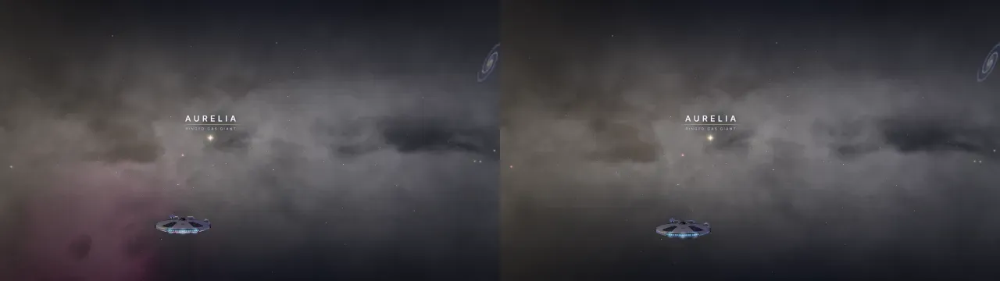

# Endless universe, lane 1: nebulae and the sky

The lane’s numbers, before and after. Plan: `docs/superpowers/plans/2026-10-18-endless-universe-lane-1-nebulae.md`. Spec: `docs/superpowers/specs/2026-10-18-endless-universe-design.md` (section D, and item 5 of “What done looks like”).

## Task 1: the before

### Where the before comes from

The lane lands on top of lane 2, so its before is the tip it starts from, not `main`. `eu/lane-1` starts at `ebfb2307`, lane 2’s PR 2.4 task 16: camera-relative drawing (PR 2.3), the budget table, the levels, the far layer, the discs and the nearest systems. Nothing of this lane’s is in it.

- **The lane’s before:** `node scripts/universe-check.mjs --quality mid --frames 3 --out lab/universe/lane1-before/mid`, run at `ebfb2307` on 2026-10-25 (exit 0, every pose ok, no page error). Mid only: the coordinator’s browser budget gives a lane one tier, and runs every tier once at the end. The numbers are `before-mid.json`; the overview pose’s shot is `before-universe.webp`.
- **`main` beside it:** the coordinator’s run of every tier at `cc5e2eaf` (`node scripts/universe-check.mjs --quality all --frames 3`), copied as `main-{high,mid,low}.json`. They show what lane 2 moved before this lane starts.

### Calls and triangles a pose

A whole frame’s draw calls and triangles from `renderer.info`, at 1280 × 720. The ten poses without a mark are `lab/universe/baseline/high.json`’s keys; † marks the other four that `universe-check.mjs` measures.

| pose | main high calls | main high tris | main mid calls | main mid tris | main low calls | main low tris | lane mid calls | lane mid tris |
| --- | --: | --: | --: | --: | --: | --: | --: | --: |
| `overview` | 98 | 540,628 | 99 | 489,042 | 63 | 476,702 | 98 | 488,962 |
| `falcon-sun` | 82 | 525,686 | 82 | 474,020 | 54 | 465,188 | 82 | 474,020 |
| `middleearth-limb` | 39 | 106,406 | 39 | 37,732 | 24 | 8,850 | 39 | 37,732 |
| `rickmorty` | 39 | 91,688 | 40 | 38,858 | 40 | 33,864 | 40 | 38,858 |
| `gaming` | 40 | 59,034 | 43 | 45,466 | 26 | 10,842 | 43 | 45,466 |
| `caribbean` | 43 | 156,166 | 43 | 87,492 | 22 | 8,834 | 43 | 87,492 |
| `belt` | 46 | 465,860 | 46 | 421,298 | 28 | 415,134 | 46 | 421,298 |
| `maw` | 43 | 77,372 | 43 | 74,250 | 27 | 8,854 | 43 | 74,250 |
| `landing-middleearth` | 129 | 181,875 | 116 | 126,980 | 116 | 126,662 | 77 | 50,796 |
| `station` | 69 | 510,880 | 69 | 459,214 | 69 | 456,836 | 69 | 459,214 |
| `middleearth` † | 39 | 106,406 | 39 | 37,732 | 17 | 4,002 | 39 | 37,732 |
| `breakingbad` † | 63 | 92,994 | 64 | 31,930 | 25 | 8,850 | 64 | 31,930 |
| `office` † | 41 | 62,606 | 41 | 23,236 | 41 | 18,242 | 41 | 23,236 |
| `far-rim` † | 42 | 85,160 | 42 | 40,598 | 39 | 36,198 | 42 | 40,598 |

The lane’s mid column matches `main`’s mid at every pose but two:

- **`overview`:** one call and 80 triangles fewer, from lane 2’s commits.
- **`landing-middleearth`:** 77 calls and 50,796 triangles against `main`’s 116 and 126,980. The lane’s shot (`lab/universe/lane1-before/mid/landing-middleearth.webp`) is bare brown ground under a dusk sky, with no smial, no trees and no green; `main`’s has all three. Its frames took 8.7 s against `main`’s 4.1 s, so the landing’s things may not have loaded before the measure (a race), or lane 2’s branch lost them. It isn’t this lane’s to fix, and the lane changes nothing a landing draws before Task 7. In Task 11, a landing that has its things again is read against `main`’s mid column, not this one.

The after goes beside the lane’s mid column in Task 11. A pose over its before there is a stop (the plan’s Task 11, step 2).

### The counts

| | before | the plan’s figure (2026-10-18) |
| --- | --: | --: |
| `wc -l src/components/universe/scene.js` | 6,374 | 6,226 |
| `glsl-sites` (budget 619) | 614 | 607 |
| `big-files` (budget 30) | 22 | 30 |

`scene.js` was 6,409 lines on `main` at `cc5e2eaf`; lane 2’s PR 2.3 took it to 6,374, and the lane’s net is measured from there. `glsl-sites` and `big-files` are `node scripts/health.mjs --only glsl-sites,big-files` at `ebfb2307`. The lane adds at most two `ShaderMaterial` sites in `nebula/` and takes out two, so `glsl-sites` ends at 614 or lower.

### Not taken here

- **Frame times** (`perf-probe.mjs universe`, twice a tier for the noise floor). Headless Chromium draws in software at a frame or two a second, so its frame times say little, and the browser budget leaves the timing to the coordinator’s measure at the end. The before can be taken again at any commit before Task 7, the first that changes what the map draws (Tasks 2 to 6 add pure files, a renderer nothing calls yet and a sky option that defaults to today’s bake).
- **The two route shots** (`autopilot-check.mjs --routes /universe` and `--routes /galaxy`, with `--before`). The overview pose stands for `/universe`. `/galaxy`’s before, which Task 11 compares pixel for pixel, can be shot at any commit before Task 6, the first to touch the galaxy’s sky (`src/components/galaxy/sky.js`); until then the galaxy is as `ebfb2307` has it.

## Task 7: the landmarks

The first task that changes what the map draws. The landmarks’ quad stands upright in the world (its up the map’s +y, `quadAxes`) and tests depth. The Veil and the Cradle are no longer drawn as landmarks. Deep space’s own clouds stand for them until Task 8 hands them to `nebula/`.

### The shader, compiled and drawn

Node can’t compile GLSL, so the landmarks were drawn alone in headless Chromium (software GL) at 960 × 540 through a 12° lens. The lab page and its script are `lab/landmarks/index.html` and `shot.mjs`, git-ignored. `main`’s `landmarks.js` (`cc5e2eaf`) is on the left of each sheet, this branch’s on the right.

- **The new program links:** no console error, `gl.getError()` 0 at every pose.
- **The one 404:** each run logs a single resource 404 on whichever page loads first, so it’s the browser’s own request, not either module.
- **The draw:** one call either way. The draw is 8 instances and 16 triangles, against 10 and 20.

`task7-stars.webp`, top to bottom:

1. **Level:** the same.
2. **Rolled 0.7 rad:** `main`’s rays stay where the screen has them. The branch’s turn with the roll, as the stars do.
3. **Straight overhead:** drawn whole, no NaN.
4. **A ball in front, drawn first:** `main`’s glare paints over it. The branch’s is hidden behind it.

`task7-maw-veil.webp`:

- **The Maw, level and rolled:** the same on both sides. Its disk was already read from its axis in the view, and it is now read in the quad’s own basis.
- **The Veil from 30,000 out:** `main` draws its painted cloud. The branch draws none, since the Veil is `nebula/`’s now.

### The counts after Task 7

- `wc -l src/components/universe/scene.js`: 6,374, unchanged. The landmarks call lost its `renderer`, `small` and `level`; the comment stayed two lines.
- `glsl-sites`: 616 after Tasks 4 and 5, now 615. The atlas’s paint material is gone.
- `big-files`: 22, unchanged.

## Task 8: deep space and the sky, wired

Deep space owns the one renderer (`nebula/`) and hands it the Veil and the Cradle; the puffs, their texture, the young stars’ `Points` and their four shaders are gone. The map’s sky is `mapSky.js`, baked with `clouds: false`. `paceTo` tells the renderer the quality step (`setLevel`), which the index plan had handed on to lane 2.

### Looked at

The map at mid in headless Chromium (software GL), 1280 × 720, through `lab/lane1-t8/look.mjs` (git-ignored): the ship held as a pose holds it, the camera set where asked, six frames, then the renderer read and a shot taken.

- **The programs link before the first frame.** Both nebula materials had a program, ready and with no diagnostics, at the warm-up (47 s in), before the canvas’s first frame (117 s). `gl.getError()` 0 at both places; no program unrunnable.
- **The console:** no shader error and no page error. The rest is what it was: the fonts’ 403s (the worktree’s `node_modules` is a link outside vite’s allow list) and frameGuard’s off-frame notes, none of them about the nebulae (theirs would name `nebula-clouds` or `nebula-fog`).

`task8-veil.webp`: the Veil from 2,600 out and 400 up: a broken shell, violet and cyan, its young stars in it, its name over it. 33 instances in the one draw (the cloud and mid’s 32 young stars); 58 calls, 482,628 triangles for the frame.

`task8-cradle.webp`: inside the Cradle, 60 from its middle: its green and blue gas round the ship, the fog shown (mid’s 3 layers), the Maw and a sun through it. 41 calls, 71,048 triangles.

These are two places of the lane’s own, not the baseline poses, so they have no before; Task 10’s poses and Task 11’s measure give the numbers beside `main`’s.

### The counts after Task 8

- `wc -l src/components/universe/scene.js`: 6,374 before, 6,349 after (the sky block out to `mapSky.js`, −26; the step in `paceTo`, +1).
- `glsl-sites`: 615, unchanged. Deep space’s materials are all made by its one `shader()` helper, so its puffs and sparks were never sites of their own.
- `big-files`: 22, unchanged. `deepspace.js` is 1,300 lines, from 1,490; `deepspaceShaders.js` 747, from 827.

## The gate: part one (Tasks 1 to 8)

Run at `5b0814b5` on 2026-10-25, in the lane’s worktree. Other lanes’ browsers and tests shared the machine all the while: its load average ran from 3 to 30 on 4 cores, and its memory limit killed one pair of browsers run side by side. So everything with a clock in it below was slower than it would be alone.

### The repo’s checks

- **`npm run lint`:** green (6 m 55 s).
- **`npm test`:** the whole suite once, 1,965 files in 56 minutes: 69 files red, 129 tests of 21,458. Every one ran out of time: 125 at the 5 s limit, and 4 over a speed budget of their own (`bf2017-hulls` 130 ms against 50, `battleTactics` 4.9 s against 4, `sector` 2.4 s against 2, `terrain` 782 ms against 250). None is in a file the lane touched.
  - The 69 files again, two workers: 10 red, all time-outs. Those 10, one worker: 2 red.
  - `scripts/health/art-mix.test.mjs` is red on `main` too (the baseline log at `cc5e2eaf`).
  - `src/components/galaxy/surface/missions/blast.test.js`, “plays out with nobody playing inside fifteen minutes”, takes 4.3 to 5.1 s against its 5 s limit on either tree. Alone, one after another: the lane 5,066 ms (red), `main` 4,944 ms, the lane 4,339 ms, `main` 4,269 ms. The lane touches nothing under `galaxy/surface`.
- **`npm run build`:** green (2 m 11 s), with the usual note on chunk sizes.
- **`node scripts/health.mjs --check --skip build`:** within budget.
- **`node scripts/flight-island.mjs --check`:** ok, 151 files on the island, 39 marked rows, 62 references.

### The poses at mid

`node scripts/universe-check.mjs --quality mid --frames 3 --out lab/universe/lane1-gate1/mid`, beside the lane’s before (Task 1, `ebfb2307`). The numbers are `gate-mid.json`. Every pose came out ok, with no page error. `breakingbad` timed out the first time, waiting 600 s for the canvas, and was run again alone.

| pose | before calls | before tris | gate calls | gate tris | calls | tris |
| --- | --: | --: | --: | --: | --: | --: |
| `overview` | 98 | 488,962 | 97 | 488,958 | −1 | −4 |
| `falcon-sun` | 82 | 474,020 | 80 | 473,936 | −2 | −84 |
| `middleearth-limb` | 39 | 37,732 | 39 | 37,728 | 0 | −4 |
| `rickmorty` | 40 | 38,858 | 40 | 38,854 | 0 | −4 |
| `gaming` | 43 | 45,466 | 42 | 45,462 | −1 | −4 |
| `caribbean` | 43 | 87,492 | 43 | 87,488 | 0 | −4 |
| `middleearth` | 39 | 37,732 | 39 | 37,728 | 0 | −4 |
| `breakingbad` | 64 | 31,930 | 64 | 31,926 | 0 | −4 |
| `office` | 41 | 23,236 | 40 | 23,232 | −1 | −4 |
| `belt` | 46 | 421,298 | 45 | 421,294 | −1 | −4 |
| `maw` | 43 | 74,250 | 43 | 74,246 | 0 | −4 |
| `landing-middleearth` | 77 | 50,796 | 142 | 138,084 | see below | |
| `station` | 69 | 459,214 | 68 | 459,210 | −1 | −4 |
| `far-rim` | 42 | 40,598 | 41 | 40,594 | −1 | −4 |

Thirteen poses are at or under their before:

- **4 triangles fewer at each:** the landmarks’ draw, 10 instances down to 8.
- **A call fewer at seven:** the sparks’ `Points`, gone.
- **At `falcon-sun`, a second call and 80 more triangles:** deep space’s puffs, gone.
- **No nebula draw in any of them:** neither the Veil nor the Cradle is in view at these poses.

**`landing-middleearth`** is counted at the first frame after the pose, while the landing is still coming in. So its count is a race, and how busy the machine is decides it.

- **The before:** caught early (77 calls). Task 1’s shot has no smial or trees yet.
- **The gate:** caught partway (142 calls), still falling frame by frame.

So both trees were measured again once the landing had settled, one browser at a time. A frame was counted until three counts in a row agreed (`lab/galaxysky/posediag.mjs`, git-ignored). The before is `ebfb2307`’s `src` exported to a scratch folder, with the rest taken from `main`, which lane 2 didn’t change:

| tree | calls | triangles | the landmarks’ draw |
| --- | --: | --: | --: |
| `ebfb2307` | 116 | 126,982 | 1 call, 20 triangles |
| the gate | 116 | 126,978 | 1 call, 16 triangles |

The landing is 4 triangles under its before too, so no pose is over. (`main`’s mid, the coordinator’s: 116 calls, 126,980 triangles.)

### What the pictures show

- **Pixels between two runs:** planet poses move 10% to 66% of their pixels between any two runs, because things turn and fly in the page’s own time. Their pixel change says nothing, so only the three still poses are compared. Each is the share moved by more than 16 in a channel, against `main` to `ebfb2307` as the noise:
  - `overview`: 4.1% (noise 2.6%)
  - `maw`: 1.2% (noise 1.1%)
  - `far-rim`: 9.8% (noise 0.5%)
- **`far-rim` (`gate-far-rim.webp`, the before on the left):** the pink cloud low on the left is gone, on purpose. It is one of the clouds the lane takes out of the map: the sky baked without its clouds (`mapSky.js`, Task 8) and deep space’s painted clouds gone. Nothing else in the shot moves.
- **The Veil and the Cradle:** neither is in any of the fourteen poses. Task 8’s shots (`task8-veil.webp`, `task8-cradle.webp`) are their pictures, and Task 10’s two poses will give them numbers.

### `/galaxy`

The galaxy’s sky was checked pixel for pixel: `lab/galaxysky/`, git-ignored.

- **Its sky:** `ebfb2307`’s `galaxy/sky.js` (its imports pointed at `/src`) beside today’s. Each was made with only the galaxy’s options (no `clouds`), set to a system and baked, then drawn from six directions at 256 × 256. Each view’s pixels were hashed.
- **The result:** all 45 systems, plus 3 with `beacons: false` (the Rick and Morty backdrop’s sky): 48 of 48 the same at every view. Every view is lit, and `gl.getError()` is 0.
- **The control:** today’s with `clouds: false` differs at both systems tried, so the check does see a change when there is one.
- **The cube:** baked small (512) with no level, so no panorama was fetched. A panorama is laid over the same bake, and the option doesn’t touch it.
- **The galaxy’s call:** `galaxy/scene.js:297` calls `createSky({ small, level, renderer })`, so it keeps the default.
- **Not taken:** the whole `/galaxy` route’s shot (`autopilot-check.mjs`). Its frames move with time, so two shots of one tree differ, and the sky is all the lane changed in the galaxy.

### Frame times

The universe check’s mean over 3 frames, in software GL at 1280 × 720: before (quiet), then the gate (loaded).

| pose | before | gate |
| --- | --: | --: |
| `overview` | 2.6 s | 5.7 s |
| `falcon-sun` | 3.2 s | 5.5 s |
| `middleearth-limb` | 2.4 s | 5.4 s |
| `rickmorty` | 1.6 s | 4.2 s |
| `gaming` | 1.5 s | 3.4 s |
| `caribbean` | 2.3 s | 3.4 s |
| `middleearth` | 1.6 s | 3.9 s |
| `breakingbad` | 1.8 s | 4.3 s |
| `office` | 0.8 s | 1.7 s |
| `belt` | 1.4 s | 2.0 s |
| `maw` | 2.5 s | 1.3 s |
| `landing-middleearth` | 8.7 s | 5.1 s |
| `station` | 3.7 s | 2.5 s |
| `far-rim` | 1.5 s | 1.3 s |

They follow the machine’s load, not the code. The later poses ran as the load fell, and came out faster than the before. The frame time worth reading (`perf-probe.mjs`, a tier twice) is left to the coordinator’s measure at the end, as Task 1 said.

### Pops

Not measured in part one. The pop-in count (anything over 4 px that appears in one frame) belongs to the whole-route check that flies into a nebula. That check comes with Task 10.

### The counts at the gate

- **`wc -l src/components/universe/scene.js`:** 6,374 before the lane, 6,349 at the gate (−25). `main` has 6,409.
- **`glsl-sites`:** 615 against the before’s 614 (budget 619). That is one over until Task 9 takes out `sectors.js`’s puff material, after which the lane ends at 614.
- **`big-files`:** 22, unchanged.
