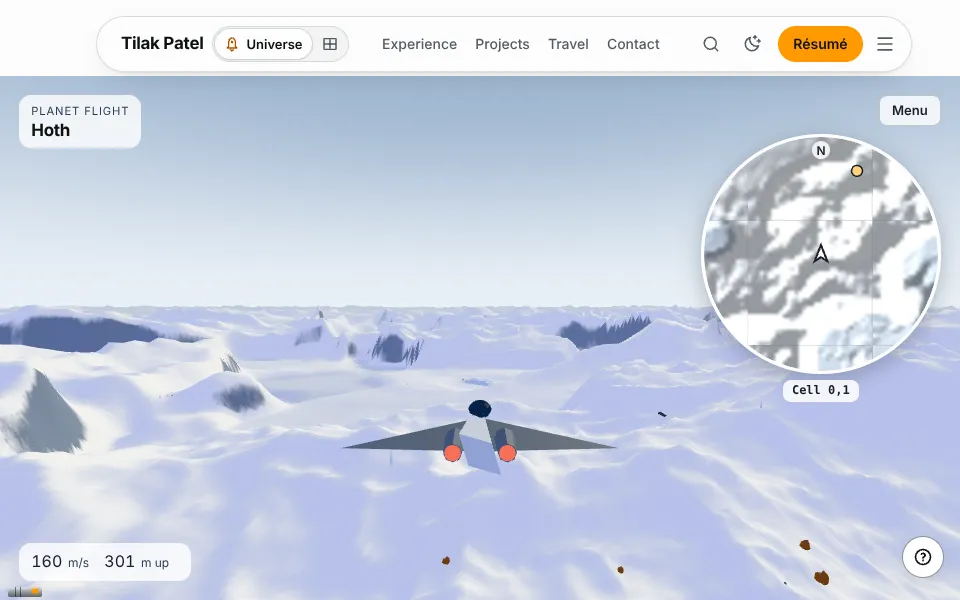
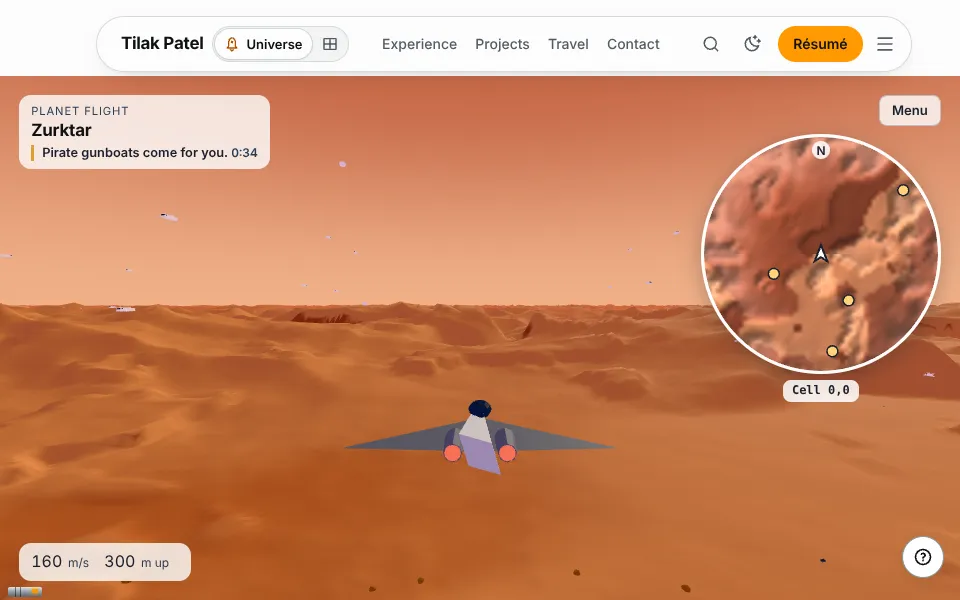
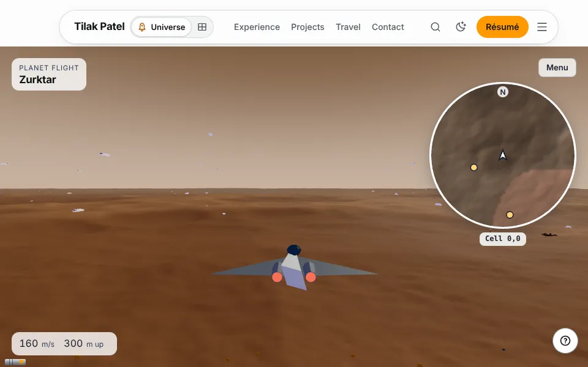
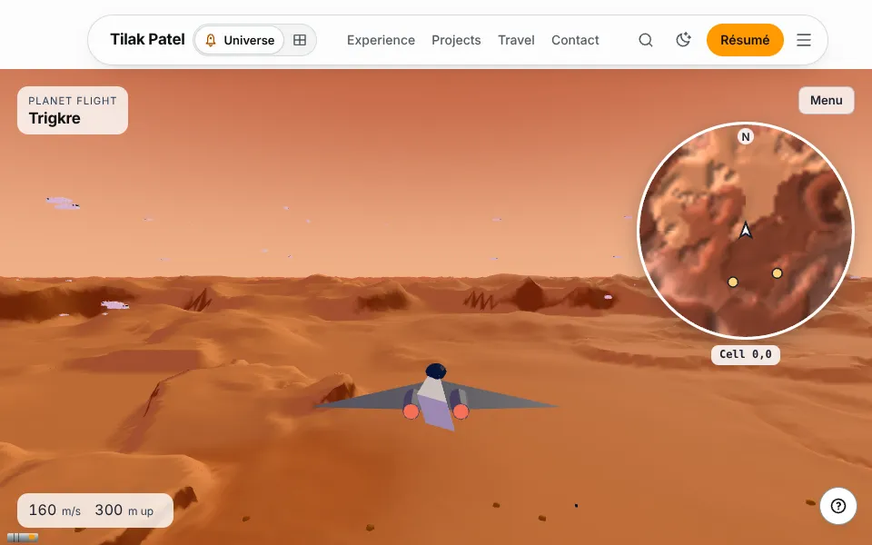
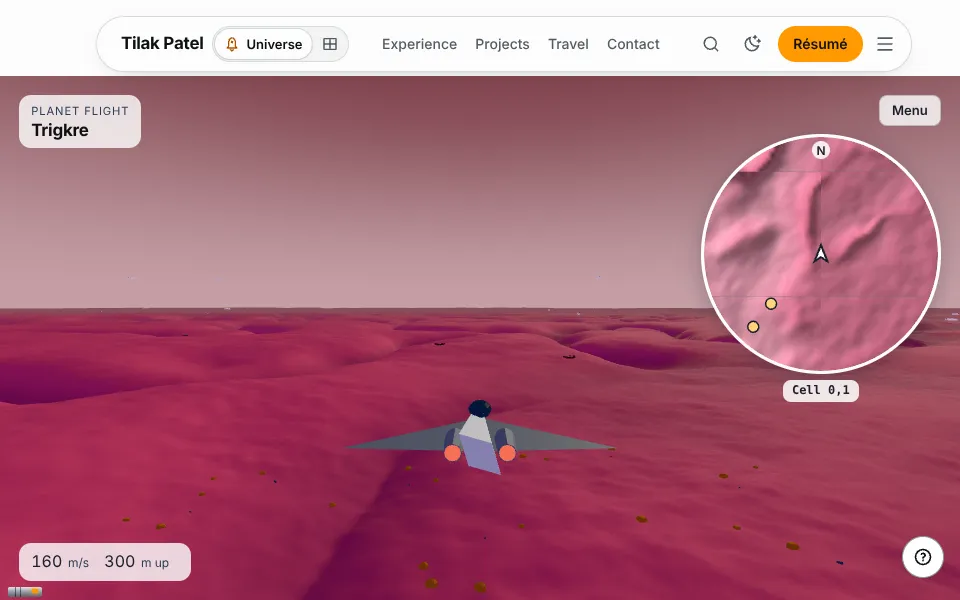
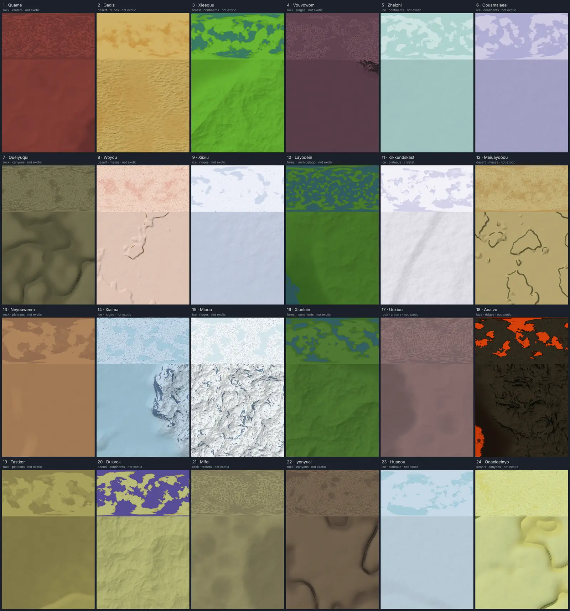

# Lane 5a: the flight before and after

Task 14’s pictures and numbers. Before is `main` at cc5e2eaf, the lane’s base. After is the lane’s head. Hand-off notes for the coordinator are in `HANDOFF-NOTES.md`.

## How it was measured

Headless Chromium on software GL (SwiftShader) in a shared container, at 960 × 600, 1× pixels, `?quality=mid&calibrate=off`, each checkout on its own dev server (the frame counters are a DEV hook). The flight was held still so two runs can be compared:

- The quality governor held (`__RUNTIME__.quality.hold`), so no step down mid-run. Every run drew at level 0, ratio 1.
- The ship put at its spawn (`module.js`’s `spawnOf` on the field alone: 3.4 km south of the first place, or at the middle where there’s none, 300 m up, nose north), and every later frame stepped with `dt` 0. From then on the ship, the camera, the life and the landmarks stand still.
- The ground left to stream until nothing was flying or pending three looks running, then 8 s more for the landmarks’ models.
- Then one frame’s draw calls and triangles (`renderer.info`, reset across exactly one frame), each scene group’s share of them (the frame counted again with that group hidden), an order-free hash of every visible position array, world matrix and instance matrix by group, and a shot of the canvas alone and of the whole page.

`/fly/<id>` is `e:3,-2:1:0` (Zurktar), the first rock planet of sector (3, −2), as the plan names it. It has no places, so `e:3,-2:1:1` (Trigkre, the next one) is shot too: its first place, a signal, is ahead of the spawn.

## /fly/hoth: the same

| | runs | draw calls | triangles | leaves | clutter |
|---|---|---|---|---|---|
| `main` | 3 | 188–189 | 540,928–540,996 | 160 | 96 |
| lane | 2 | 188–189 | 540,928–541,144 | 160 | 96 |

- The lane’s first run is pixel for pixel `main`’s first two, on the canvas and on the whole page (HUD, map and all): 0 pixels differ.
- `main`’s third run differs from its first by 17 pixels, all in a 130 × 60 px box in the middle of the screen: specks of the life or of an event, whose state at the hold depends on how many frames ran before it. The lane’s second run differs from `main`’s first by 18 pixels round the same spot.
- The ground group (166 meshes, 375,976 triangles) hashes alike on `main` and the lane. So do Echo Base, the trench, the sky and the ship. Only the life, the events and the ion cannon change from run to run, so the spread in calls and triangles is theirs. The ion cannon hashed two ways over the lane’s two runs, and one of them is `main`’s.

 

## /fly/e:3,-2:1:0 and /fly/e:3,-2:1:1: changed on purpose

On `main` both are the rock template’s plane, in one orange. On the lane each is round, in its own colours: Zurktar a brown craters world under a hazy sky, Trigkre a magenta canyons world with its signal ahead.

| | `main` calls | `main` triangles | lane calls | lane triangles |
|---|---|---|---|---|
| Zurktar | 81–82 | 1,097,188–1,101,236 | 81 | 1,041,344 |
| Trigkre | 79 | 1,060,606 | 91 | 723,398 |

Trigkre was shot twice on each side, with the same counts both times. Zurktar was shot twice on `main` and once on the lane.

Trigkre’s share of the frame, by group:

| group | `main` calls | `main` triangles | lane calls | lane triangles |
|---|---|---|---|---|
| ground (`flight-ground`) | 56 | 127,302 | 57 | 133,782 |
| life (`flight-life`) | 6 | 819,410 | 5 | 473,094 |
| events (`flight-occurrences`) | 2 | 372 | 4 | 564 |
| the signal (`landmark:poi-0`) | none | none | 8 | 2,436 |
| the rest (the sky, the ship and the like) | 15 | 113,522 | 17 | 113,522 |

- Trigkre draws 12 more calls than on `main`. 8 are its signal, a place it didn’t have. 2 are the events, which vary from run to run. The ground and the rest draw 3 more between them, and the life 1 fewer.
- Its triangles fall by a third. Its life costs 473,094 where rock’s template beasts cost 819,410: its own fauna are Task 9’s code-built shapes.
- It has 15 to 16 shader programs where `main` has 12, and 7 textures where `main` has 5. The signal is new to it, and its fauna aren’t rock’s.
- Zurktar has no places, and draws no more than on `main`.

 

 

No run on either side had a page error or a console error outside `scripts/lib/noise.mjs`’s list. One lane run’s tab crashed (“Target crashed”) while the container was short of memory, and the next page in that browser never came on. Shot again, one page to a browser, every page came on in 7 to 10 s.

## The perf probe

`FLY=hoth VIEW=960x600@1 QUALITY=mid BASE=… node scripts/perf-probe.mjs fly`, once on each side. The container was shared with other browsers, builds and test runs, and frames of 30 to 130 s stalled both runs, so the ship flew a different path each time and the phases’ counts don’t compare. The held-still counts above are the comparison.

| phase | `main` draws | `main` ktris | lane draws | lane ktris |
|---|---|---|---|---|
| settle | 144 | 432 | 150 | 453 |
| fly | 176 | 520 | 191 | 545 |
| bank | 186 | 531 | 187 | 536 |
| play | 182 | 526 | 189 | 541 |

The programs alive at the end (25) and the late pipelines (4) are the same on both.

## The contact sheet

Task 13’s `node scripts/planet-contact-sheet.mjs` (seed 1), scaled to 1,600 px wide: 24 generated planets, each from orbit over 3 km of its ground. The full-size sheet and each planet’s pictures are written to `lab/planets/contact/`.
