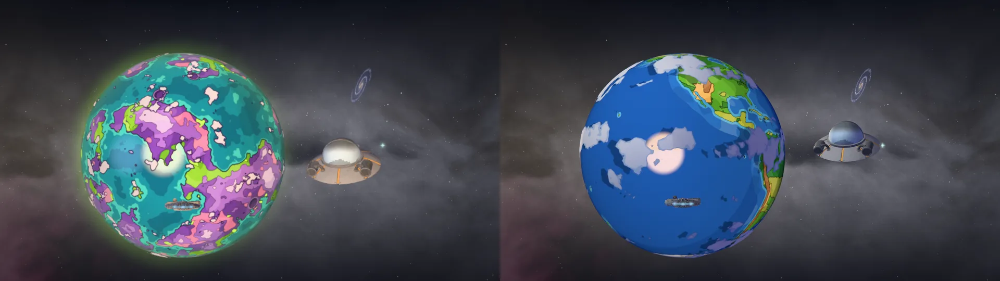
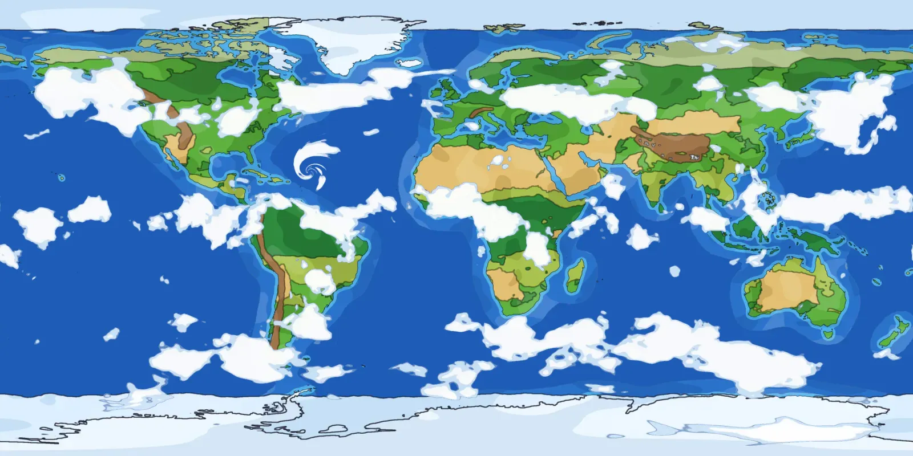
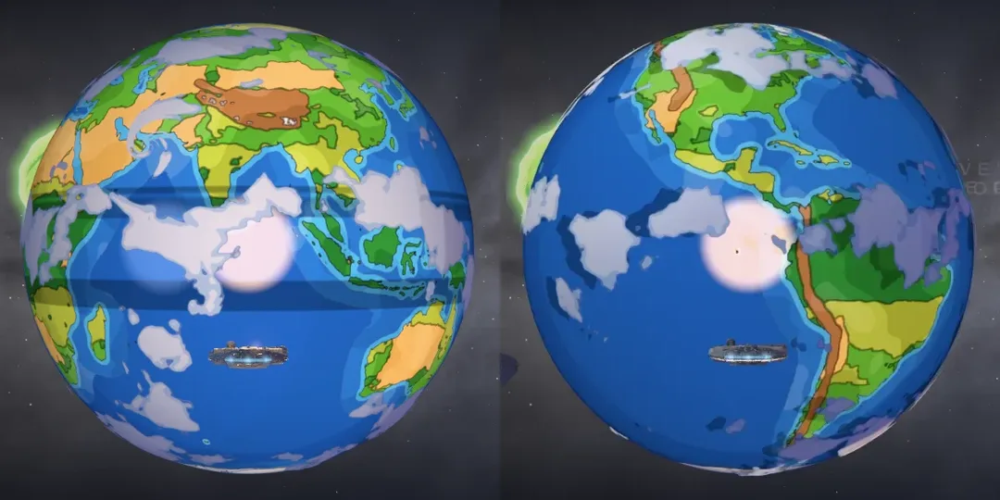

# C-137 as the Smiths’ Earth, and the stripes across the cloudy planets

Shots on `/universe` in software GL (SwiftShader), 1280 × 720, so the frame times compare only with each other; the planets turn, so which face shows differs between shots.

## C-137

Before (left): the show’s idea of an alien world (purple lands, pink deserts, lime ooze, cartoon craters), which no episode shows as C-137. After (right): Earth as the show draws it from orbit, on Natural Earth’s coasts (`scripts/planets/earth.mjs`, shared with Marvel’s Earth-616): flat colour in three cel tones a fill, inked in the show’s dark line, the show’s bright blue sea with the cyan shallows round every coast, greens and tans by climate, the ranges brown with snow on their crests, white ice, and the show’s puffs of cloud with a sky-blue underside; its air and rim the sky’s blue, not the portal’s lime. At night the real Earth’s cities, in the show’s warm yellow (`rickmorty-night`, in place of the ooze’s glow). Ultra, the ship parked 2.4 radii out on the sun side, turned 0.35 radians round (the before on `main` before the portal-jump merge, the after on this branch).

Its landing reads the map’s tan for the hills out past town, where the portal came out (`landings.js`’s `hills`: hue 22 to 50, the deserts and the ranges); the rest is the Smiths’ street, as before.

## The stripes

High, `scripts/universe-check.mjs`’s `rickmorty` pose. Two things ruled lines across a planet’s sea:

- **The cloud shadows** (left, the hard dark bands): the shadows are read from the cloud map where the clouds have turned to, u less the turn, and the map was clamped at its edge, so past the turn its last column was smeared along the latitudes. It wraps now, set as it loads and before it’s first sent up (`planetMaps.js`’s `wrapRound`, worn by the far maps and the near ones): every planet with a cloud layer had it (Middle-earth, New Mexico, the Caribbean, Invincible, Hogwarts’ world, Earth), the wider the further its clouds had drifted.
- **The fill on the cel-shaded planets** (C-137, Earth-616, the Rick and Morty sector’s worlds): `celShade` drew every light in its three bands, the scene’s cool fill too, so it ruled three more lines and put a second sun’s glint in the sea. Only the planet’s own sun is banded and glints now (`keySun.js` says it’s there, `KEY_SUN`); the fill is a soft wash under it.

## Draw calls and triangles

`scripts/universe-check.mjs --quality high --frames 3`, on the same dev server, `main`’s five source files swapped in for the before:

| pose | before (`main`) | after |
| --- | --- | --- |
| `overview` | 98 calls, 567,433 triangles | 98 calls, 567,433 triangles |
| `rickmorty` | 37 calls, 118,413 triangles | 37 calls, 118,413 triangles |

No mesh more or less: C-137 drops its emissive glow map for a night map read by the air’s hook it already had.
