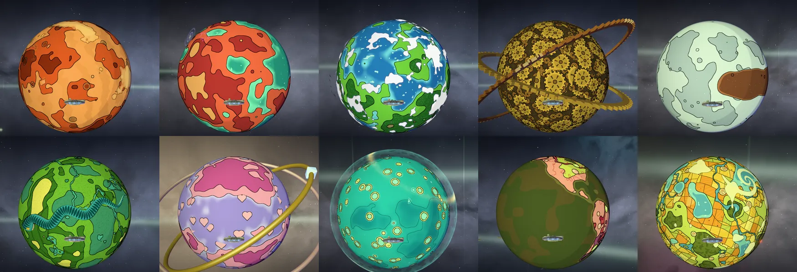
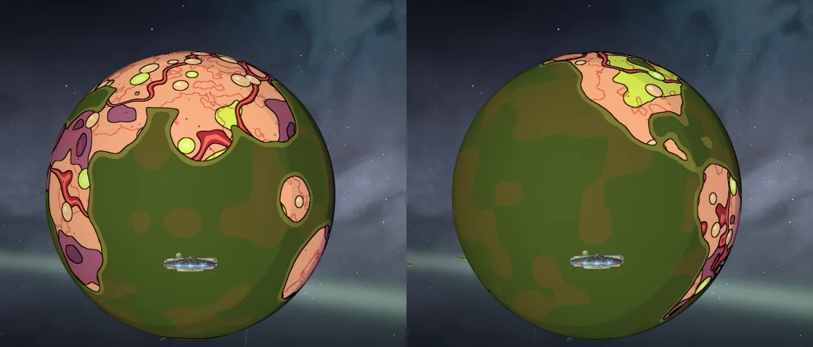

# The Rick and Morty sector’s ten worlds, looked at; Cronenberg World on the real Earth

Shots on `/universe` at ultra in software GL (SwiftShader), 1280 × 720, the ship parked 2.4 radii out on the side the Curve’s sun lights, turned 0.35 radians round. The worlds turn, so which face shows differs between shots.

Gazorpazorp, Planet Squanch, Bird World, Gear World, Pluto; Snake Planet, Nuptia 4, the Immortality Field Resort, Cronenberg World, the Purge Planet. Each one’s ground is its own shader (`rmWorldsGlsl.js`), worked out where it’s drawn, so it’s as sharp at the surface as from orbit, with no map to run out of texels at 4K. Nine already read as their places, and they stay as they were.

## Cronenberg World

It’s the Earth Rick and Morty left behind in “Rick Potion #9”: C-137’s own, which this map now draws as the Smiths’ Earth. Its flesh lay on 32 round blobs where the continents roughly are (left). Now it lies on the real coasts (right: the Americas, Baja and the isthmus, the Pacific gone murky), read from `cronenberg-land` (Natural Earth’s land through `scripts/planets/earth.mjs`, softened about two degrees either side, 12 KB). The coasts are still pushed about by the shader, a little lumpy as the show would draw them, and they still breathe. Without the map (a failed load) it falls back to the blobs (`RM_LAND`, its own program in the cache).

## Draw calls and triangles

At Cronenberg World’s pose, high, one frame’s count, the lane before’s three source files swapped in for the before (the sector’s traffic moves the count between runs):

| | before | after |
| --- | --- | --- |
| run 1 | 48 calls, 148,691 triangles | 40 calls, 144,959 triangles |
| run 2 | 50 calls, 151,689 triangles | 40 calls, 144,959 triangles |

No mesh more: the world reads one small map more, nothing else.
