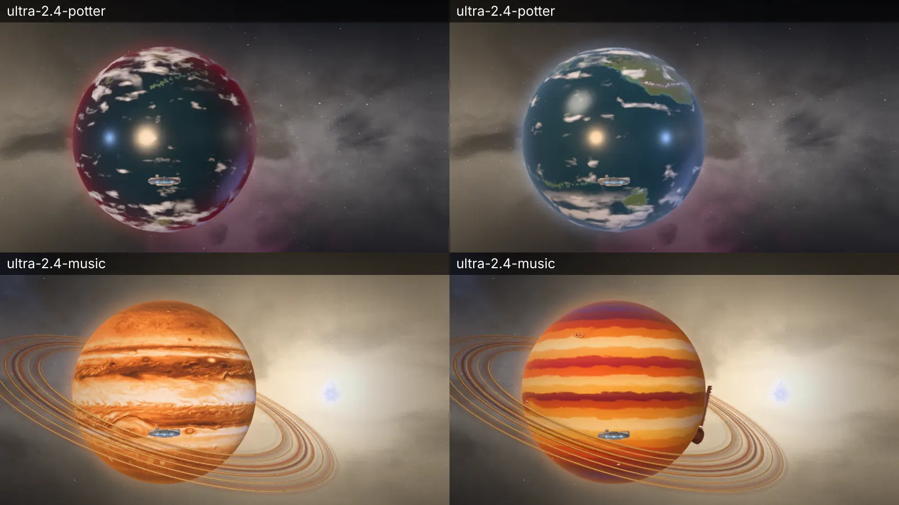
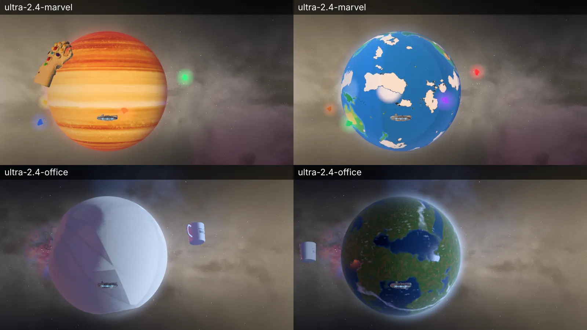
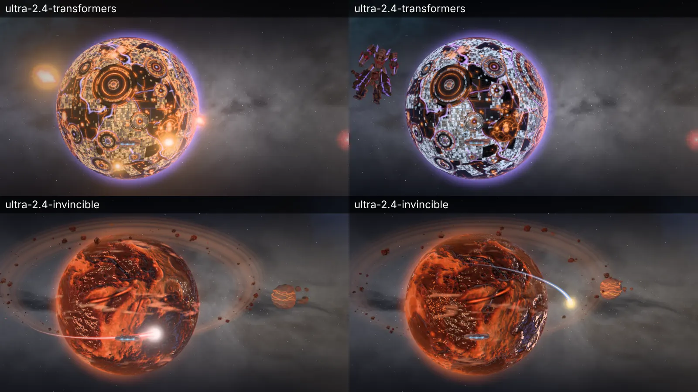

# The fandoms’ planets as their own worlds, and sharp at 4K

Before (left) and after (right) of each planet that changed, on `/universe` at ultra, 1280 × 720, the ship parked 2.4 radii out on the planet’s sun side, turned 0.35 radians round so a limb shows. Software GL (SwiftShader), so the frame times compare only with each other. The poses are `scripts/universe-check.mjs`’s planet pose (`poses.js`, `{ planet, dist: 2.4, off: 0.35 }`) set through the DEV hook; the planets turn, so which face shows differs between shots.

## What each was, and is

| planet | before | after | its maps (largest, ultra worn near) |
| --- | --- | --- | --- |
| Hogwarts’ world (`potter`) | the sea near black, the rim Gryffindor’s scarlet (a planet’s rim is its swatch without a `rim`) | the North Atlantic’s grey-teal, Highland air for its rim, the Continent across the ocean with Beauxbatons and Durmstrang lit | `potter-xl.ktx2` 4096 |
| the music room (`music`) | Jupiter in saffron, the Great Red Spot and all | a giant of its own: a Banarasi silk’s bands, zari threads, harmonic waves on the band edges, paisley storms, a lotus at each pole | `music-xl.ktx2` 4096 (and the -hq down from 341 to 144 KB) |
| Marvel (`marvel`) | Saturn in gold and red | Earth-616 as the comics draw it, on Natural Earth’s coasts: inked, Ben-Day dots, the Savage Land, Wakanda, Avengers Tower, cel lit, its clouds painted on | `marvel-xl.ktx2` 4096, `marvel-night` and `-rough` 1024 |
| the Office (`office`) | a crumpled sheet of letterhead | Scranton’s country: the ridge and valley round the Lackawanna in autumn, the real rivers, coast and lakes, the branches lit at night, cumulus in the map | `office-xl.ktx2` 4096, `office-normal-hq` 2048, `office-night` 1024 |
| Cybertron (`transformers`) | lit orange by its fires (level 2.2) and amber cities | steel, its cities blue-white, the fires at 0.85; the colour map unchanged | new `transformers-xl.ktx2` 4096 (was 2048 at most) |
| Invincible (`invincible`) | 1024 colour, its rifts at 2.4 to 3.2 and a heavy dust | worked out at 4096, the rifts at 1.4 to 2.1, the dust at 0.7, the belt’s dust 0.2 and 110 rocks (150) | new `invincible-xl.ktx2` 4096, `invincible-hq` 2048 |

## Draw calls and triangles

`scripts/universe-check.mjs --quality high --frames 3`, on the same dev server, `main`’s four universe source files swapped in for the before:

| pose | before (`main`) | after |
| --- | --- | --- |
| `overview` | 96 and 98 calls (two runs), 567,353 and 567,433 triangles | 98 and 97 calls (two runs), 567,433 triangles |
| `office` | 39 calls, 66,451 triangles | 39 calls, 89,331 triangles |

The overview’s spread is the map’s own (traffic and events), the same either side. At `office` the planet now wears the finer sphere every round planet wears near (the crumpled ball was a geometry of its own, never made finer); counted in the page, planet by planet at high, the Office has 5 meshes before and after and 19,688 triangles to 23,496 far, and Invincible 22 meshes, 32,660 triangles to 34,100. No planet has a mesh more: Marvel’s and the Office’s clouds are painted into their maps, not a shell.
