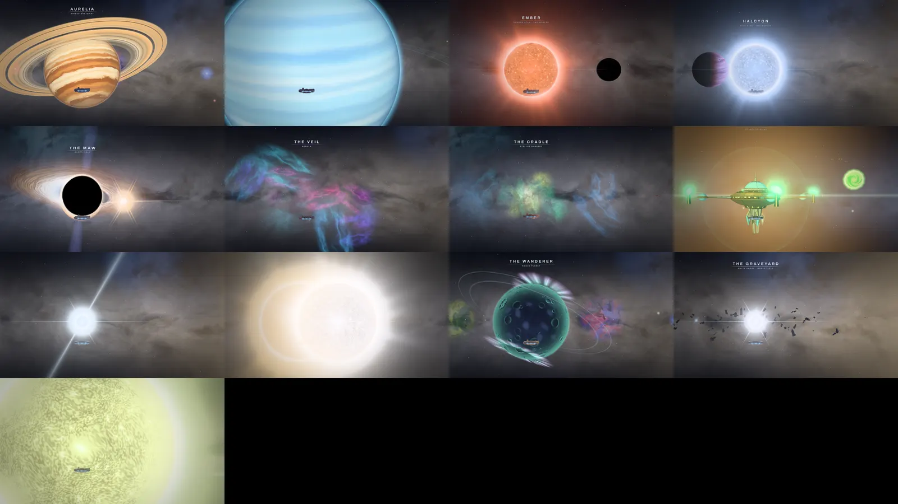
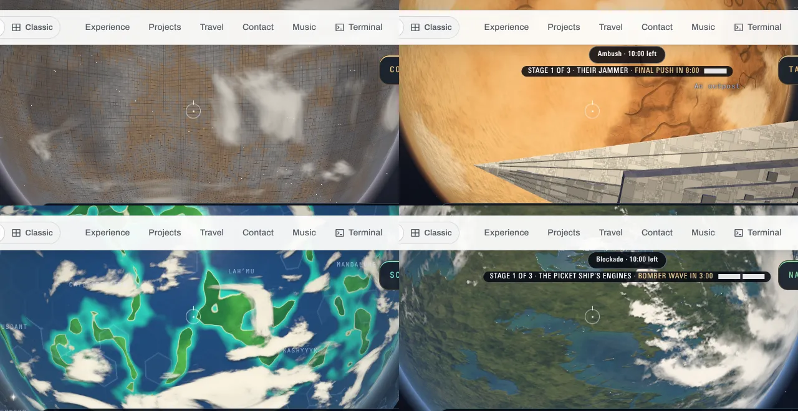

# The wonders and the galaxy’s worlds, looked at

The last of the hand-off’s “planets, canon” item: every wonder in deep space and a set of the galaxy’s worlds shot as they stand on `main` (2026-10-23), to see what a pass would need. Software GL (SwiftShader), ultra, 1280 × 720.

## The wonders

Left to right, top to bottom: Aurelia, Glacia, Ember, Halcyon; the Maw, the Veil, the Cradle, the Citadel; the Lantern, the Twins, the Wanderer, the Graveyard; the Curve’s Sun. The ship parked 2.4 of each one’s reaches out (`deep.js`’s `reachOf`) on the home sun’s side. All but the Citadel are the map’s own, not a fandom’s, so the canon they answer to is the sky’s:

- **Aurelia and Glacia**: a ringed gas giant and an ice giant, banded, with a storm.
- **Ember and Halcyon**: an orange star and a blue one, each with its planets. Ember’s ocean world is black here because it’s crossing the star, its night side to the camera.
- **The Maw**: a black hole with its photon ring and its disk bent over the top.
- **The Veil and the Cradle**: nebulae, with dust lanes and young stars.
- **The rest**: a pulsar with its beams, a binary, a rogue planet lit only by its auroras, and a white dwarf in a field of hulls.
- **The Citadel**: the show’s, its dome, arms and hanging blades.

Each is drawn in its own shaders, worked out where it’s drawn, so none has a map to run out of texels at 4K. Nothing to change. At this range the Twins are two suns blown white into each other; from further off they’re two.

## The galaxy’s worlds

`scripts/galaxy-check.mjs space` at ultra, parked off each world on its sun side (crops of the frame above its HUD). The eight shot all read as their films’ worlds:

- **Tatooine’s** tan desert and canyons.
- **Hoth’s** snow.
- **Coruscant’s** city grid under cloud.
- **Mustafar’s** lava.
- **Scarif’s** atolls under its shield’s hexagons.
- **Naboo** and **Endor** in their greens. Endor wears the 2017 game’s own skin, as Bespin, Naboo, Kamino and five more do: `src/data/planetSkins.json`.
- **Bespin’s** peach bands.

Two things to look at in their own lane, both in the procedural ground (`bodyShaders.js`), not lore:

- Tatooine’s dune streaks read as brushed fur this close.
- Coruscant’s day side is a flat grid, where the films show towers and canyons of light.
